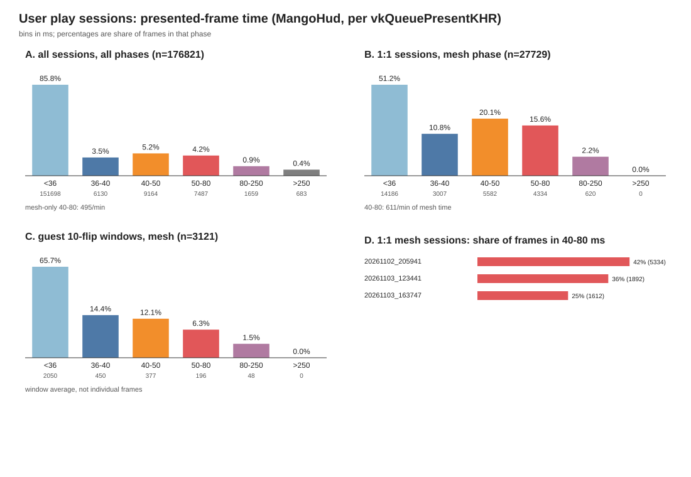
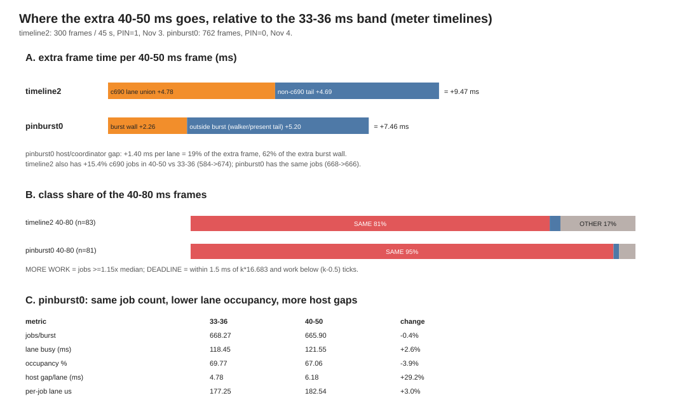

# Long frames (40-80 ms): the user's sessions, and what the meter timelines say

Date: 2026-11-04. Offline analysis only: **no game launch, no build**. Data is
already on disk from the user's play sessions and from the meter A/B runs.
Follows [`hitch-census.md`](hitch-census.md),
[`pin-and-burst-path.md`](pin-and-burst-path.md),
[`frame-pacing-floor.md`](frame-pacing-floor.md),
[`frame-timeline.md`](frame-timeline.md) and
[`frame-timeline-2.md`](frame-timeline-2.md).

## TL;DR

* **In the user's sessions, 40-80 ms frames are common in mesh scenes and rare
  elsewhere.** 176,821 presented frames in 35 sessions (78.6 min of CSV span):
  **16,651 are 40-80 ms (9.4 %, 222/min of frame time)**. In the mesh phase it
  is **14,787 of 66,132 frames (22.4 %, 495/min)**; in menus 0.38 %, boot 0.3 %,
  loading 8.8 %. The 1:1-present sessions (MangoHud rows per guest frame) are
  **9,916 of 27,729 mesh frames (35.8 %, 611/min)**.
* **The exact 40-80 ms population cannot be attributed frame-by-frame in real
  play.** The hitch recorder keeps only >250 ms; the play logs' `[flip]` lines
  are every 10th flip (or every flip during boot), so they give 10-frame
  averages, not per-frame times. `hitches.pstl` explains the >250 ms class
  (boot/start-screen SPU asset jobs and first-use shader translation, not
  c690), and the presented-frame population is 89 % mesh-phase, but the
  40-80 ms causal split needs the capture in §4.
* **Where per-frame data exists (pitch meter), the 40-80 ms frame is NOT more
  c690 work.** 300-frame timeline2: 40-50 ms frames have 674 c690 jobs vs 584
  in 33-36 (but 680 in 36-40, i.e. the same batch as the frames just below
  them), the same per-job time, **lower lane occupancy (0.558 vs 0.644)** and
  a longer non-burst tail. 762-frame pinburst0: **666 jobs vs 668** in 33-36,
  occupancy 0.671 vs 0.698, host/coordinator gap **+1.40 ms per lane (+29 %)**.
* **Class shares of the 40-80 ms meter frames: SAME WORK SLOWER 81 % / 95 %
  (timeline2 / pinburst0), DEADLINE SLIP 2.4 % / 1.2 %, OTHER 17 % / 3.7 %,
  MORE WORK 0 % in both.** The extra time is about half c690 work and half
  non-c690 tail in timeline2 (+4.78 / +4.69 ms), and 30 % burst / 70 %
  outside-burst in pinburst0 (+2.26 / +5.20 ms). Deadline slips are a small
  tail concentrated at ~50 ms.
* **The one cheap, already-available guard is the present/affinity setup**
  (PIN=0, x11, FIFO, `PRESENT_NEW_ONLY=1`, `PACE=1`). In real play 40-80 ms
  frames are over-represented in seconds whose SDL pump gap is >=40 ms
  (90.4 % mesh vs 78.0 % for normal 33-36 ms frames), and the old
  MAILBOX/Wayland sessions had 1.4-1.9 presents per guest frame. Among the 1:1
  sessions the mesh 40-80 share runs 25-42 % (205941 42 %, 123441 36 %,
  163747 25 %). This is a suspect, not a proven cause; do not change the
  present path blindly.

## 1. The user's sessions

### 1.1 Data and phase rule

35 `play_*` sessions have both a MangoHud CSV and a log. Frames are the CSV
`frametime` values (one row per `vkQueuePresentKHR`), filtered to
`0 < frametime < 10000`; 8 bad rows were dropped. Phase per frame:

* `boot`: elapsed < 20 s;
* `load`: frame > 250 ms, or within 3 s after one;
* `menus`: `[c690-stats]` jobs/s < 100;
* `mesh`: jobs/s >= 100 (gameplay and cinematics).

The split is a heuristic: the log has no scene markers and c690 samples are
every 2-3 s. Phase edges are uncertain by 1-2 s. MangoHud logs **present
calls**, not guest flips; on Nov 3+ builds `PRESENT_NEW_ONLY=1` makes the two
close (CSV/guest fps 0.9-1.1 in 18 of 35 sessions), but old sessions with
MAILBOX/re-presents have 1.4-1.9 rows per guest frame. The 1:1 subset below is
the clean one.

### 1.2 Histogram (all sessions, all phases)

Bins are ms; 176,821 presented frames, 74.8 min of frame time.

| bin | frames | share |
|---|---:|---:|
| <36 | 151,698 | 85.8 % |
| 36-40 | 6,130 | 3.5 % |
| 40-50 | 9,164 | 5.2 % |
| 50-80 | 7,487 | 4.2 % |
| 80-250 | 1,659 | 0.9 % |
| >250 | 683 | 0.4 % |

Overall **40-80 = 16,651 = 222/min of frame time**. The same bins per phase:

| phase | frames | min | p50 | p90 | p99 | 40-50 | 50-80 | 80-250 | >250 | 40-80/min |
|---|---:|---:|---:|---:|---:|---:|---:|---:|---:|---:|
| boot | 33,020 | 9.80 | 16.4 | 32.0 | 34.0 | 12 | 20 | 20 | 0 | 3.3 |
| menus | 59,512 | 17.79 | 16.6 | 32.2 | 37.2 | 164 | 63 | 12 | 0 | 12.8 |
| mesh | 66,132 | 29.87 | 24.6 | 51.6 | 90.2 | **8,314** | **6,473** | 1,095 | 0 | **495.1** |
| load | 18,157 | 17.38 | 18.2 | 56.9 | 1013.8 | 674 | 931 | 532 | 683 | 92.4 |

Mesh holds **88.8 %** of all 40-80 ms frames (14,787 of 16,651); menus 1.4 %,
load 9.6 %, boot 0.2 %. **This is the user's complaint in one line: in mesh
scenes a fifth of presented frames is 40-80 ms, and it is 8-10 frames per
second.**

### 1.3 1:1-present sessions

The subset with CSV/guest fps in 0.9-1.1 (18 sessions) removes the
re-present inflation:

| phase | frames | min | p50 | p90 | p99 | 40-50 | 50-80 | 80-250 | >250 | 40-80/min |
|---|---:|---:|---:|---:|---:|---:|---:|---:|---:|---:|
| boot | 15,606 | 5.36 | 17.0 | 31.4 | 33.4 | 0 | 1 | 16 | 0 | 0.2 |
| menus | 16,276 | 6.37 | 18.6 | 32.4 | 37.1 | 21 | 28 | 9 | 0 | 7.7 |
| mesh | 27,729 | 16.24 | 35.5 | 56.5 | 97.2 | **5,582** | **4,334** | 620 | 0 | **610.8** |
| load | 5,793 | 5.88 | 26.1 | 68.7 | 897.3 | 314 | 458 | 262 | 227 | 131.3 |

**Mesh: 9,916 of 27,729 frames are 40-80 ms (35.8 %).** Per session:

| session | ratio | n | p50 | p90 | p99 | mesh 40-50 | mesh 50-80 | mesh 40-80 | /min |
|---|---:|---:|---:|---:|---:|---:|---:|---:|---:|
| play_20261102_205941 | 0.93 | 15,656 | 33.2 | 57.2 | 110.0 | 3,002 | 2,332 | 5,334 | 686.6 |
| play_20261103_123441 | 0.97 | 7,989 | 30.1 | 58.5 | 114.1 | 756 | 1,136 | 1,892 | 571.1 |
| play_20261103_163747 | 0.99 | 12,137 | 28.7 | 42.7 | 72.1 | 1,208 | 404 | 1,612 | 500.2 |
| play_20261103_231651 | 0.98 | 3,527 | 28.1 | 45.1 | 107.1 | 324 | 136 | 460 | 460.2 |
| play_20261103_214017 | 0.97 | 2,478 | 27.2 | 52.6 | 99.6 | 135 | 252 | 387 | 701.1 |
| play_20261103_214151 | 0.99 | 2,374 | 26.6 | 42.5 | 97.2 | 157 | 74 | 231 | 609.2 |

The remaining 1:1 sessions are UI/boot runs (p50 16-20 ms, zero mesh 40-80).
The two highest rates (214017, 214151) have <1 min of mesh time; treat them as
noisy. The large, current sessions are **25-42 % of mesh frames in 40-80 ms**.



### 1.4 Guest cadence over 10 flips

`[flip]` lines are every 10th guest flip after boot (every flip during boot;
the N delta detects which), so each interval is a 10-frame average, not a
single frame. In mesh, 6,749 windows: 750 (11.1 %) average 40-50 ms, 354
(5.2 %) 50-80, 80 (1.2 %) 80-250; **16.4 % of 10-flip windows average 40-80 ms**
versus 35.8 % of presented frames in the 1:1 mesh sessions. Some of the
difference is the averaging (one long frame in ten can still average <40) and
some is display-side; this cannot be separated without per-frame guest data.
It does show that long frames cluster on the guest side too, not only in the
window.

## 2. Per-frame attribution where per-frame data exists (pitch meter)

Two independent windows have c690 per-job/per-frame data:

* `ab_live_timeline2_20261103_065615` — 300 frames (200-499) of a 45 s meter
  window, PIN=1, Nov 3 build; per-frame CSV.
* `ab_live_pinburst0_20261104_014302` — 762 frames / 511 bursts, PIN=0, Nov 4
  build; per-burst records joined to frames by midpoint. (pinburst1, PIN=1, is
  used as a check.)

Both are the stationary pitch meter, not real play; the 40-80 band there is
dominated by 40-50 ms (only 2-3 frames are 50-80 and none >80).

### 2.1 Band table

timeline2 (means; `putout` = walker put wait outside drain+idle):

| band | n | frame | c690 jobs (median) | c690 union | sum lane | us/job | occupancy | drain | idle | present fence | main work | ref wait | putout |
|---|---:|---:|---:|---:|---:|---:|---:|---:|---:|---:|---:|---:|---:|
| <33 | 84 | 16.58 | 98 (82) | 3.83 | 11.69 | 119.5 | 0.150 | 5.40 | 1.83 | 7.55 | 0.34 | 16.24 | 9.35 |
| 33-36 | 86 | 34.00 | 584 (602) | 32.02 | 109.40 | 187.2 | 0.644 | 21.50 | 5.70 | 8.14 | 19.92 | 13.15 | 6.80 |
| 36-40 | 47 | 38.08 | 680 (680) | 34.56 | 118.21 | 173.9 | 0.621 | 24.42 | 8.89 | 5.18 | 19.48 | 17.65 | 4.77 |
| 40-50 | 81 | 43.47 | 674 (681) | 36.80 | 120.97 | 179.4 | **0.558** | 26.60 | 10.50 | 7.01 | 20.82 | 21.69 | 6.36 |
| 50-80 | 2 | 51.30 | 680 (680) | 41.39 | 124.97 | 183.8 | 0.487 | 25.11 | 13.53 | 4.69 | 22.68 | 27.58 | 12.66 |

pinburst0 (means; gap/host/tail/head are **5-lane totals**, divide by 5 for
per-lane; `*_us` fields are nanoseconds in the raw JSON):

| band | n | frame | burst wall | union | jobs | lane busy | occupancy | gap | host | tail | head | serial | us/job |
|---|---:|---:|---:|---:|---:|---:|---:|---:|---:|---:|---:|---:|---:|
| 33-36 | 285 | 34.26 | 33.93 | 33.57 | 668 | 118.4 | 0.698 | 50.55 | 23.91 | 14.25 | 12.38 | 0.037 | 177.2 |
| 36-40 | 144 | 38.22 | 34.52 | 34.11 | 678 | 120.7 | 0.699 | 51.33 | 24.09 | 14.56 | 12.68 | 0.031 | 178.0 |
| 40-50 | 78 | 41.72 | 36.20 | 35.60 | 666 | 121.6 | **0.671** | 58.46 | **30.89** | 14.92 | 12.65 | 0.034 | 182.5 |
| 50-80 | 3 | 53.34 | 41.18 | 39.59 | 684 | 127.3 | 0.636 | 77.44 | 44.51 | 19.62 | 13.31 | 0.020 | 186.1 |

Reading:

* **Job count is flat.** pinburst0: 666 in 40-50 vs 668 in 33-36 (-0.4 %).
  timeline2: 674 vs 584 (+15.4 %) against 33-36, but **680 in 36-40** — the
  40-50 frames carry the same batch as the frames just below them, so the extra
  milliseconds are not extra scene content.
* **Per-job lane time is flat** (timeline2 179.4 vs 187.2 us, -4 %; pinburst0
  182.5 vs 177.2 us, +3 %). The lanes are not doing more work per job.
* **Occupancy falls** (0.644 -> 0.558 timeline2; 0.698 -> 0.671 pinburst0), the
  inter-job gap rises (5-lane 50.55 -> 58.46 ms, +15.5 %), and the
  host/coordinator part rises **+29 % per lane (+1.40 ms)**. The serial
  tail is 0.02-0.04 ms, so it is not one lane finishing late.
* **The frame also has a non-burst tail:** timeline2 +4.69 ms of non-c690 time;
  pinburst0 5.20 ms outside the burst (walker/present/flip tail). The walker
  drain in 40-50 is 26.60 ms, below the burst union, so the walker is not the
  producer.

### 2.2 Classification

Rules (same as `tools/hitch_table.py --classify`):
`MORE WORK` = c690 jobs >= 1.15x the all-frame median and c690 covers >= half
the frame; `DEADLINE SLIP` = frame within 1.5 ms of k*16.683 ms **and** c690
work below (k-0.5)*16.683 ms; `SAME WORK SLOWER` = c690 covers >= half the
frame without more jobs; `OTHER` = the rest. Precedence MORE > DEADLINE >
SAME > OTHER.

| 40-80 source | n | MORE WORK | SAME WORK SLOWER | DEADLINE SLIP | OTHER |
|---|---:|---:|---:|---:|---:|
| timeline2 | 83 | 0 (0 %) | **67 (80.7 %)** | 2 (2.4 %) | 14 (16.9 %) |
| pinburst0 | 81 | 0 (0 %) | **77 (95.1 %)** | 1 (1.2 %) | 3 (3.7 %) |
| pinburst1 (check) | 145 | 0 (0 %) | 134 (92.4 %) | 1 (0.7 %) | 10 (6.9 %) |

The timeline2 `OTHER` frames are mostly 693-702 jobs, 10-12 % above the median
but below the 1.15x MORE-WORK threshold, plus one 45 ms main-ref frame with no
c690. pinburst1 `OTHER` includes frames whose midpoint falls between two
bursts. **There is no MORE WORK frame in either dataset.**

DEADLINE SLIP is small but real: the slips sit at 49-51 ms (3 x 16.683 =
50.05 ms). The 33-36 baseline produces 0-2.8 % false positives with the same
test, so the 1-2 % is not a classifier artifact.

### 2.3 Where the extra milliseconds go

| source | extra frame vs 33-36 | c690/burst part | non-c690/outside-burst part |
|---|---:|---:|---:|
| timeline2 40-50 | **+9.47 ms** | c690 lane union **+4.78** (50 %) | tail **+4.69** (50 %) |
| pinburst0 40-50 | **+7.46 ms** | burst wall **+2.26** (30 %) | outside burst **+5.20** (70 %) |

For pinburst0 the host/coordinator gap is **+1.40 ms per lane**, which is 19 %
of the extra frame but **62 % of the extra burst wall**; tail/head are flat
(+0.13/+0.05 ms per lane). This reproduces the published big-burst numbers
(host 5.03 ms / 14.4 %, gap 10.61 ms / 30.3 %) and shows the **long bursts are
more host-turnover-heavy**: 40-80 host 6.28 ms / 17.1 % of wall, gap 11.83 /
32.4 %, versus 33-36 host 4.78 / 14.0 %, gap 10.11 / 29.8 %. But the host term
is still only about a fifth of the *frame* excess; most of the pinburst0 extra
is outside the burst.



### 2.4 Answer to the mission's question

For the frames where per-frame data exists: **the same c690 work running
slower**, plus a longer non-burst tail. Not more jobs/vertices (0 % MORE WORK;
job counts identical or only boundary-split), and only ~1-2 % deadline slips
(at ~50 ms). The slowdown is per-job dispatch turnover — especially the
host/coordinator phase (+29 % per lane, 62 % of the extra burst wall) and the
lower lane occupancy it causes — and, in pinburst0, a ~5 ms tail after the
burst. The 50-80 and 80-250 real-play bins are not represented at the meter
(2-3 frames), so their split remains unmeasured.

## 3. The >250 ms frames in the user's sessions

`hitches.pstl` keeps only >250 ms. Four sessions have content, 53 hitches,
46.3 s total (`play_20261103_231637` and `play_20261104_074859` are empty):

| session | hitches | total | dominant causes | largest |
|---|---:|---:|---|---|
| play_20261103_202606 | 19 | 19.0 s | spu.run 16 (12.49 s clipped), rsx.drain 2 (6.20 s), c690.job 1 (0.31 s) | 5.55 s match load (shader 3.06 s); 2.05 s replay `spu.run` at 216.9 s; boot 0.67-0.95 s |
| play_20261103_214017 | 15 | 12.2 s | spu.run 15 (12.23 s) | 2.59 s at 46.8 s (start screen); boot 0.59-0.88 s |
| play_20261103_214151 | 17 | 13.9 s | spu.run 17 (13.91 s) | 2.36 s at 46.1 s, 2.27 s at 76.5 s |
| play_20261103_231651 | 2 | 1.2 s | rsx.drain 2 (1.20 s, shader 22/169 ms) | 0.93 s at 36.6 s; 0.27 s at 101.8 s |

This is the known split from [`hitch-census.md`](hitch-census.md): the
user-visible >250 ms freezes are **not c690**; they are the title's SPU asset /
DXT jobs while the main thread polls, and first-use shader translation on the
RSX walker. The 80-250 ms bin (1,659 presented frames) is not captured at all.

## 4. Capturing the 40-80 ms frames in the next play session

The existing play recorder threshold is 250 ms
(`recomp-work/play_windowed.sh:116`), so the 40-250 ms population has no
per-frame evidence. Lower it for one session.

### 4.1 Threshold and sizes, from the code

* `PS3RECOMP_TIMELINE_HITCH_US=40000` keeps frames longer than 40 ms, i.e. the
  40-50 bin (the complaint includes 40 ms). 50-80, 80-250 and >250 are kept by
  the same test.
* `PS3RECOMP_TIMELINE_RING_MB=32`: per-thread ring (`ps3_trace.h:779`); a
  40-80 ms frame is ~160-175 KiB of records across all threads (measured:
  246 MB / 1,412 frames in the 45 s timeline2 window, c690 stats on), so a
  single long frame needs well under 1 MiB per ring. 16 MiB is enough; 32 MiB
  leaves room for a 250 ms hitch.
* `PS3RECOMP_TIMELINE_FLUSH_MB=2`: hitch mode **clamps the flush to 2 MiB**
  (`ps3_trace.h:783`); setting 4 is silently clamped, so keep 2.
* Disk volume: ~160-175 KiB per captured frame. At 490-611 long frames/min in
  mesh (and up to 667/min in the worst old session) a mesh-heavy session writes
  **80-115 MiB/min**, so plan **~0.5 GiB per 5 minutes** and keep the file in
  `/tmp`. A 10-minute 205941-style session would be ~1 GiB.
* Overhead: the hooks are always armed when the timeline is on; hitch mode only
  filters what the flusher writes. The measured cost is the full-timeline cost
  (+0.03 ms p50, +0.29 p90, +0.71 p99, +0.32 mean;
  [`frame-timeline.md`](frame-timeline.md) §2.3), plus one clock and a ring
  write per flip. The flusher polls every 5 ms (`PS3_TR_POLL_MS`) and drains
  only when a hitch window is queued. At 10 long frames/s the extra I/O is the
  dominant new cost, not CPU.
* `PS3RECOMP_TIMELINE_SECS`/`TRIGGER` do **not** apply in hitch mode
  (`ps3_trace.h:791` requires `!hitch_ns`), so the run ends when the game
  exits; keep the session short rather than relying on a timer.

### 4.2 Command (run from the repo root; do not change the script defaults)

```sh
cd /home/m/Documents/mlb16-online/recomp-work
PS3RECOMP_TIMELINE=/tmp/longframes_$(date +%Y%m%d_%H%M%S).pstl \
PS3RECOMP_TIMELINE_HITCH_US=40000 \
PS3RECOMP_TIMELINE_RING_MB=32 \
PS3RECOMP_TIMELINE_FLUSH_MB=2 \
./play_windowed.sh
```

Recommended session: boot to a match, then 3-5 minutes of the pitch/meter and
one cinematic or replay, then exit. That mixes mesh long frames, a >250 ms
hitch and the 50-80 bin.

### 4.3 Analysis

```sh
cd /home/m/Documents/mlb16-online
python3 mlb16-recomp/tools/hitch_table.py /tmp/longframes_*.pstl \
  --min-ms 40 --bins --classify --baseline-jobs 680 \
  --csv /tmp/longframes.csv --top 40
```

`--bins` prints the six-bin histogram; `--classify` labels each hitch. Pass
`--baseline-jobs 680` (the meter's median) so `MORE WORK` means "more jobs than
the normal meter frame"; without it the tool uses the file median, which for a
40 ms-only capture is biased toward the long frames. The per-hitch CSV has
time, duration, dominant cause and cause ms; join it with the log's
`[c690-stats]`/`[RSX vulkan]` lines (or the MangoHud CSV) by elapsed time.

What to look for: if the 40-80 hitches are `c690.job`-dominant with **jobs near
680** and c690 union near the frame, it is SAME WORK SLOWER and the §5 host
levers apply. If they have **jobs well above 680**, it is MORE WORK (scene
content) and native kernels / culling matter. If the dominant cause is
`present.*`, `rsx.drain`, `spu.run`, `shader.compile` or `fs.read`, it is
OTHER and should be fixed on that path. DEADLINE SLIP shows as a duration
within 1.5 ms of 50.05/66.73/83.42 ms.

## 5. Ranked fixes (by 40-80 ms frames removed, not by p50)

Estimates are for the 1:1 mesh sessions (611 long frames/min; 5,582 in
40-50, 4,334 in 50-80). "Removed" means the frame drops below 40 ms (or leaves
the 50-80 band), not just gets faster. Confidence is from the measured
per-frame split, not from a run of the fix.

| # | fix | evidence | est. 40-80 removed | cost |
|---:|---|---|---|---|
| 1 | **Cut the c690 host/coordinator turnover** (fewer dispatches per job, batched submission; first try the existing `SPURS_PM_FAST_RESCHED` knob at 16/32) | 81-95 % SAME WORK SLOWER; host gap +1.40 ms/lane, 62 % of the extra burst wall; perfect fast reschedule is worth -5.0 ms of a 35 ms burst ([`pin-and-burst-path.md`](pin-and-burst-path.md)) | **up to ~40 % (≈250/min)** if the full 5 ms goes; a 2 ms cut removes ~15-20 % | cheap probe (`SPURS_PM_FAST_RESCHED`, `libs/spurs/cellSpurs.c:1807-1817`); real fix medium. The old dispatch-cuts build cut 3.26 ms of burst but lost 2 fps; only keep a version that does not delay other work |
| 2 | **Cut c690 compute** (all-SPU codegen 1.2-1.4x; native 0x21 sel1/7 and 0x2A) | compute is ~70 % of a 35 ms burst; 1.2x removes ~6 ms of burst; 0.7x of the long-frame excess is burst-related | **~30-40 % (≈180-250/min)** at 1.2x; native 0x21 sel1/7 alone ~3-5 ms -> ~10-20 % | expensive; codegen/native missions already running ([`spu-codegen-audit.md`](spu-codegen-audit.md), [`c690-emit-ring.md`](c690-emit-ring.md)) |
| 3 | **Present/pump starvation and re-presents** | displayed 40-80 frames sit in seconds with max pump gap >=40 ms 90.4 % of the time (mesh) vs 78.0 % for 33-36; 1:1 mesh long share 35.8 % vs 16.4 % of guest 10-flip windows; old MAILBOX sessions 1.4-1.9 presents/guest | possibly **20-40 % of displayed frames (≈120-240/min)**, but unproven until §4 | cheap guards already on: PIN=0 (`recomp-work/play_windowed.sh:107`), x11/FIFO/NEW_ONLY/PACE (`:173`, `:178`, `:192`), present queue/drop (`libs/video/rsx_vulkan_backend.c:190`, `:2185`). Probe a higher present/pump priority next session; do not enable PIN=1 |
| 4 | **Shorten the non-burst tail** (walker drain + flip/present after the last PUT) | +4.69 ms timeline2, +5.20 ms pinburst0 of the extra frame | ~15-20 % (≈100-120/min) | high risk: the safe-looking early completions (`TICK_IN_DRAIN`, `FLIP_FENCE_DONE`) lose 8.4-9.4 fps ([`frame-pacing-floor.md`](frame-pacing-floor.md)); only a design that preserves the buffer-ref wait can be tried |
| 5 | **Honour the guest's 16683 us deadline exactly** | DEADLINE SLIP is 1.2-2.4 % of 40-80, all at ~50.05 ms; our two 17 ms host timeouts leave the deadline branch at 34.13 ms vs the guest's 2 x 16683 = 33.37 ms | **~1-2 % (≈10-15/min)**; a 50.05 ms slip could become ~49 ms (40-50 band) | cheap-ish but small: `runtime/ppu/ppu_sysprx.cpp:462`/`runtime/ppu/lwcond_real.h:167` |
| 6 | **Add a sixth c690 lane** | the workload has 5 lanes; 6 would cut burst ~16 % | maybe 10-15 %, but `SPURS_LANE6` wedges in ~10 s (`libs/spurs/cellSpurs.c:1869`) | blocked; needs a different design |
| – | **PIN=1** | 140 vs 79 long frames in pinburst, p90 42.4 vs 40.1, present stalls 1.58/0.82 s | negative | do not use; PIN=0 is already the default |

**Cheap and explicit:** the affinity/present defaults are already the right
ones (`recomp-work/play_windowed.sh:107`, `:173`, `:178`, `:192`); keep them and
do not regress to MAILBOX/re-presents. `SPURS_PM_FAST_RESCHED` is already 8; a
16/32 value is a zero-build experiment on exactly the host gap that makes the
long frames longer (`libs/spurs/cellSpurs.c:1807`). The lwcond-deadline change
is small and cheap but targets only ~2 % of the frames.

**What not to do for this complaint:** content reductions aimed at vertices
(MORE WORK = 0 at the meter) and native per-stage cull work (0.3 ms) will not
remove 40-80 ms frames; they only move p50 once the burst shrinks a lot. The
>250 ms class is a different problem (SPU asset jobs / shader translation; §3).

## 6. Artifacts and reproduce

* `docs/long-frames-hist.png` — the session histograms (all phases, 1:1 mesh,
  guest 10-flip windows, per-session shares).
* `docs/long-frames-decomp.png` — extra-ms decomposition and class shares.
* Analysis scripts (not committed; they read only the logs/CSVs/JSON on disk):
  the play census re-derives the CSV+`[flip]`/`[c690-stats]`/`[RSX]` tables;
  the timeline/burst scripts read `timeline_per_frame.csv` and `burst*.json`.
* `tools/hitch_table.py --bins --classify [--baseline-jobs N]` is the
  per-hitch view for the §4 capture.

```sh
cd recomp-work/ab-tools/longframes     # analysis copies, not committed
python3 final_numbers.py               # session phase/bin tables
python3 classify_final.py              # per-frame class counts
python3 tl_class.py                    # timeline2 / 2026-11-02 band tables
python3 burst_class.py                 # pinburst0/1 band tables
python3 make_plots.py && convert long-frames-hist.svg long-frames-hist.png
python3 make_plots2.py && convert long-frames-decomp.svg long-frames-decomp.png
```

## Caveats

* The user-session census uses MangoHud present rows, not guest flips. On old
  builds with re-presents (Nov 2, MAILBOX/Wayland) the row rate is 1.4-1.9x the
  guest rate; those sessions inflate the presented long-frame count. The 1:1
  subset is reported separately and is the one to use for current builds.
* Phase edges are heuristic (c690 samples every 2-3 s, no scene markers);
  post-hitch frames are `load` for 3 s, which is why the mesh share (88.8 %) is
  lower than a naive mesh+menus split.
* The per-frame attribution is the **pitch meter**, not real play, and PIN
  differs between the two windows (timeline2 PIN=1, pinburst0 PIN=0). It cannot
  speak for the 50-80 and 80-250 real-play bins.
* The `pinburst*.json` `*_us` fields are nanoseconds despite the name; the
  timeline2 `walker_put_wait_ms` column is shifted (it holds the spurs-kick
  count). `walker_put_extra_ms` and `walker_other_no_put_ms` are the real put
  waits (13.62 and 7.12 ms means); the tables use the corrected fields.
* Bursts are joined to frames by midpoint; a frame containing two burst
  midpoints appears twice (affects 10 pinburst1 frames).
* Fix estimates are counterfactuals from the measured split, not measurements
  of the fixes; the batching/priority and present-priority probes still need
  the §4 run or an A/B.

## Clean room

This is our own analysis of our runtime's trace stream, the game's own logs and
our own captures. No RPCS3 or other GPL emulator source was read or cited; the
only external method attribution is the MIT NHL Legacy Native stage/corpus
method, already credited in [`pin-and-burst-path.md`](pin-and-burst-path.md).
