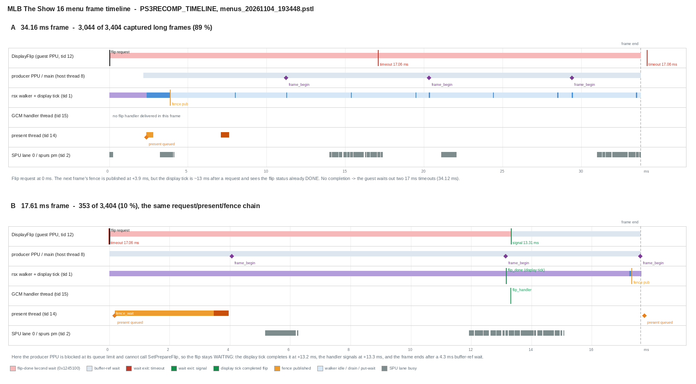

# Menus: the 34 ms frames are the display tick being blocked by the title's own prepare-ahead status write

Date: 2026-11-04. Diagnosis only: no code change, no build, no game launch.
Branch `exp/live-ab` (HEAD `87cfe3aa`) in `ps3recomp-play`, user's play build
`recomp-work/build-play`. Evidence: the user's menu capture
`recomp-work/captures/menus_20261104_193448.pstl` (103 MB, 146.2 s, start
screen / main menu / team select, `PS3RECOMP_TIMELINE_HITCH_US=17000`, so every
frame > 17 ms is in the file) and `recomp-work/play_20261104_193448.log`. Both
were recorded with the standard play environment (`GCM_HANDLER_THREAD=1`,
`GCM_FLIPCB_ONTICK=1`, `PS3RECOMP_FLIP_*` all off).

This follows [`meter-p50-pin.md`](meter-p50-pin.md),
[`flip-deadline.md`](flip-deadline.md),
[`frame-pacing-floor.md`](frame-pacing-floor.md),
[`walker-cuts-2.md`](walker-cuts-2.md) and
[`targets-and-backlog.md`](../targets-and-backlog.md).

## TL;DR

* **The menu 34 ms mode is the guest's own `Gfx_DisplayFlip` fallback: two
  17 ms waits (34.12-34.16 ms). It is not a fixed 30 fps cap and not the
  c690 producer.** The walker does ~0.13 ms of work per report and then
  sleeps ~23.6 ms; there are **no `c690.job` events at all** in the menu
  capture.
* **It is not a lost wakeup and not handler-thread latency. In 3,044 of
  3,404 long frames the completion is never generated.** The only completion
  edge for this title is the display tick (`GCM_FLIPCB_ONTICK=1` suppresses
  the request-time callback; `FLIP_ON_DONE`, `FLIP_FENCE_DONE` and
  `TICK_IN_DRAIN` are off). `cellGcmTickFlip` only completes a flip while the
  HLE's `s_flip_status` is `WAITING` (cellGcmSys.c:1047-1065). The title
  prepares frames ahead on the main PPU and our `cellGcmSetPrepareFlip`
  writes `s_flip_status = DONE` (cellGcmSys.c:4334). In menus that call lands
  **p50 3.07 ms after the flip request** (p90 4.40 ms), while the next display
  tick is ~13 ms after a request. The tick therefore always finds `DONE` and
  skips; the display thread waits out both 17 ms timeouts.
* **The 353 short frames are the same machine, caught at a different moment.**
  When the producer PPU is blocked at its frame-ahead limit it does not call
  `Gfx_FrameEnd`/`SetPrepareFlip` before the tick; the status stays `WAITING`,
  the tick completes at **p50 +13.43 ms**, the handler runs 0.08 ms later, the
  wait exits by signal at **p50 +13.55 ms**, and the frame ends at
  **+17.6 ms** after a 4.3 ms buffer-ref wait. 353/353 of these frames have a
  completion; 1/3,044 of the 34 ms frames does.
* **Frame census**: 6,120 guest flips in 146.23 s = **41.8 fps**; 3,044 frames
  at 34.12-34.16 ms (89 %), 353 at 17-20 ms (10 %), 6 other. The log's vblank
  counter settles it: **9,154 ticks / 6,120 flips = 1.494**. 3,044 two-tick
  frames need 6,088 ticks, the other 3,076 flips take one tick each, and
  6,120 + 3,044 = 9,164 ≈ 9,154. Every 34 ms frame is exactly one extra
  display tick spent on a flip the tick refused to complete.
* **Fix direction**: make our completion decision independent of the guest's
  `s_flip_status` word, using our own outstanding-flip state, and only for a
  flip the guest is still waiting for (age < its first 17 ms wait). That turns
  every two-tick frame into a one-tick frame; menus should go to **one flip
  per vblank, ~55-60 fps** (today 41.8), i.e. RPCS3 parity. It should be a
  no-op at the meter, where the tick is instead **starved by the ~33 ms c690
  drain** and the frame is producer-bound. The 282/853 meter two-timeout
  frames are not this bug (KEEP_STATUS=1 removed only 823 -> 776 of them and
  cost 4.3 fps).
* This is a *proposal*, not measured. It differs from the earlier negative
  experiments; see sections 5 and 6.



## 1. Frame census and the two classes

`tools/hitch_table.py` and a direct PSTL parse (`PSTL` header, 32-byte
records `t0,t1,a,b,ev,pad`; the record's thread is the block header `tid`,
not the last field). Thread names in the file: `rsx walker` (1), `spurs pm`
(2-6), `spurs kernel` (9), `ppu DisplayFlip` (12), `present` (14),
`host thread 15` (the GCM interrupt thread, `GCM_HANDLER_THREAD=1`),
`ppu Display Engine` (16) and `host thread 8` (the main PPU producer path).

| class | n | share | duration p50 | two timeouts | completion in frame |
|---|---:|---:|---:|---:|---:|
| 34 ms | 3,044 | 89.4 % | 34.142 ms | **3,044 / 3,044** | **1 / 3,044** |
| 17-20 ms | 353 | 10.4 % | 17.55 ms | 82 (the rest are one timeout for the *next* frame's wait or a signal) | **353 / 353** |
| other | 6 | 0.2 % | 52.9 ms | 2 | 6 |

The log adds what the hitch capture cannot: `[flip]` lines sample the flip
count and vblank count every 10th flip. First sample #1 at 0 ms (`vc=11`),
last #6,120 at 146,230 ms (`vc=9,154`):

| quantity | value |
|---|---:|
| guest flips | 6,120 |
| vblank ticks | 9,154 |
| ticks / flip | **1.494** |
| flips / s | **41.85** |
| ms / flip | 23.90 (p10 15.0, p50 24.0, p90 34.0) |

3,044 frames take two ticks and the remaining 3,076 take one; that predicts
9,164 ticks, and 9,154 were seen. There is no third mechanism: the 34 ms
class is exactly "one extra display tick per frame".

The cost of the fallback is visible directly. A 34.16 ms frame:

| t from flip request | event (thread) |
|---:|---|
| 0.001 ms | `gcm.flip_request` / `gfx.frame_end` (DisplayFlip, tid 12) |
| 0.003-17.066 | flip-done lwcond wait (DisplayFlip, `0x1245100`) |
| 2.17-11.23 | next frame's ref lwcond wait (producer, tid 8) |
| 2.34 ms | present queued (walker, tid 1) |
| **3.86 ms** | next frame's fence executed and published (`gcm.ref_set`, walker) |
| 17.066 ms | wait exit: **timeout**, 17.06 ms |
| 17.075-34.139 | flip-done lwcond wait (DisplayFlip) |
| 34.137 ms | wait exit: **timeout**, 17.06 ms |
| 34.151 ms | next flip request (frame end) |

A 17.61 ms frame, same request/present/fence chain:

| t from flip request | event (thread) |
|---:|---|
| 0.001 ms | flip request (DisplayFlip) |
| 0.18 ms | present queued (walker) |
| 0.19-3.47 | present fence wait (present, tid 14) |
| 4.08-13.14 | next frame's ref lwcond wait (producer, tid 8) |
| **13.15 ms** | **`gcm.flip_done`** (walker; the display tick completed the flip) |
| 13.30 ms | `gcm.flip_handler` (GCM interrupt thread, tid 15) |
| 13.315 ms | wait exit: **signal**, 13.31 ms elapsed |
| 13.32-17.60 | buffer-ref wait for the *next* frame (DisplayFlip) |
| 17.32 ms | next fence published (walker) |
| 17.60 ms | next flip request (frame end) |

Aggregates over the matched classes:

| term | 34 ms class | 17-20 ms class |
|---|---:|---:|
| request -> present queued | p50 0.15 ms | p50 0.18 ms |
| request -> next fence published | **p50 3.07 ms** (p90 4.40) | **p50 17.32 ms** (p90 17.67) |
| request -> `gcm.flip_done` | 1 sample (17.42) | **p50 13.43 ms** (p90 17.15) |
| request -> `gcm.flip_handler` | 1 sample (17.69) | **p50 13.51 ms** (p90 17.29) |
| wait-exit kind | 6,087 timeout / 1 signal | 358 signal / 82 timeout |
| timeout length | p50 17,059 us | p50 17,060 us |
| signal elapsed | - | p50 13,269 us |

The GCM interrupt thread is not the problem: flip-done -> flip-handler is
**0.08-0.15 ms** (it polls every 250 us), handler -> wait-exit **0.02 ms**.
The present thread is not the problem: present is queued p50 0.15 ms after the
request and `vkQueuePresentKHR` is not on the guest path. The walker is not
the problem: `[walker-prof]` p50 `walker=0.132 ms`, `wait=23.582 ms` over 902
reports, and no c690 job runs in menus.

## 2. Static: what `Gfx_DisplayFlip` waits on, and who is supposed to signal it

`Gfx_DisplayFlip` (`EBOOT+0x000692dc`, Ghidra) per iteration:

1. wait for a queued frame: `Cond_Wait(&DAT_012450a0, 9000)` while
   `DAT_011203dc == DAT_011203d8` (consumer == producer);
2. wait for *this* frame's buffer ref: `Cond_Wait(&DAT_01245068, 9000)` while
   `DAT_01245020[consumer & 3] != *(u32 *)(DAT_01123b00 + 8)`, then clear the
   slot;
3. `DAT_011203e0 = DAT_011203dc; sys_time_get_system_time();`
   `cellGcmResetFlipStatus(); cellGcmSetFlipImmediate(id);`
4. wait for the flip handler with an outer deadline:
   `while (DAT_011203e0 != 0) { if (now - start < (DAT_011203f8 << 1))
   Cond_Wait(&DAT_012450d8, 17000); else DAT_011203e0 = 0; }`.

`Cond_Wait` is `sys_lwcond_wait(mutex + 0x28, timeout, 0)`; mutex base
`0x12450d8`, so the flip-done lwcond is **`0x1245100`**, the buffer-ref lwcond
is **`0x1245090`**. `DAT_011203f8` is 16,683 us in the 720p mode
(`FUN_00064b68`), i.e. the outer deadline is 33.366 ms, reached after two
17,000 us host waits (17.06 ms each). The mode has not changed: this run's
timeouts are 17,059-17,064 us.

`Gfx_FlipHandler` (`EBOOT+0x000691b0`) is the only writer that matters here:

```c
if ((DAT_011203e0 == 0) || (DAT_011203dc == DAT_011203e0)) {
    DAT_011203dc++;                       /* advance the consumer        */
    FUN_00061734(...);                    /* hand the next buffer over   */
    DAT_011203e4 = 0;
    Mutex_LockOwned(&DAT_012450d8, 0);
    DAT_011203e0 = 0;                     /* clear the frame being waited */
    FUN_009a311c(&DAT_012450d8);          /* sys_lwcond_signal_all       */
    Mutex_UnlockOwned(&DAT_012450d8);
}
```

So the signal comes from `Gfx_FlipHandler`, which is the guest OPD registered
by `cellGcmSetFlipHandler` (the log shows `opd=0x010B2D18`). Our runtime:

* delivers it from `ppu_gcm_pump` (`libs/video/cellGcmSys.c:997-1006`) only
  after a completion was marked (`GCM_PENDING_SET(2)`); with
  `GCM_HANDLER_THREAD=1` the delivery runs on the dedicated host thread
  `gcm_intr_main` (cellGcmSys.c:956-975), polling every 250 us;
* marks the completion in `cellGcmTickFlip` -> `gcm_flip_complete` ->
  `gcm_flip_complete_locked(GCM_FLIP_GATE_TICK)` (cellGcmSys.c:1047-1065,
  1099-1114). The tick gate is exactly:

```c
if (s_flip_status == CELL_GCM_FLIP_STATUS_WAITING &&
    gcm_flip_executed_take())
    seq = s_flip_req_seq;
```

The vblank handler only increments the vblank count; the GCM user handler is
unrelated. The request-time callback path (`gcm_flip_request` ->
`g_ps3_guest_caller(s_flip_handler_opd, 0, ...)`, cellGcmSys.c:4213-4214, and
`cellGcmSetPrepareFlip` at 4353-4354) is **disabled** by `GCM_FLIPCB_ONTICK=1`
in the play scripts, so the tick (and only the tick) is the completion edge.

### Where the wrong status comes from

`cellGcmSetPrepareFlip` is called by `Gfx_FrameEnd` (`EBOOT+0x00066530`) on
the main PPU for every frame it prepares, and our HLE writes:

```c
if (!keep_status) s_flip_status = CELL_GCM_FLIP_STATUS_DONE;   /* cellGcmSys.c:4334 */
```

This is a compatibility write, not the SDK behaviour: prepare only queues a
buffer and returns its id. It is normally invisible because at the meter the
title prepares late and the tick is often earlier; `PS3RECOMP_PREPARE_FLIP_KEEP_STATUS`
was added for exactly the meter investigation
([`flip-deadline.md`](flip-deadline.md) section 4) and stayed off because
removing the write cost 4.3 fps at the meter. In menus the opposite timing
holds: the producer is fast, so the write lands **p50 3.07 ms** after the flip
request, ~10 ms before the next tick.

`Gfx_FrameEnd` also writes the next frame's fence right after the prepare
(`FUN_0006309c(&DAT_00f32644)` -> `DAT_01245020[slot]`). That fence is the
`gcm.ref_set` at +3.86 ms in the 34 ms frame, i.e. the prepare has already
returned at that point. It is also why the *next* buffer is ready long before
the fallback ends; the display thread is not waiting on work, it is waiting on
a completion we chose not to send.

## 3. Why the completion is missed in the 34 ms class (evidence chain)

1. The status gate is the only possible blocker. `gcm_flip_request` sets
   `s_flip_status = WAITING` and `s_flip_direct_pending = 1`
   (cellGcmSys.c:4168-4176). `gcm_flip_executed_take()` consumes the pending
   flag only when a completion attempt passes the gate, so a tick that saw
   `WAITING` would have completed. In the 34 ms class 3,043/3,044 frames have
   no `gcm.flip_done` at all; the tick ran (vblank advances twice, section 1)
   and was not starved (walker p50 0.13 ms).
2. `SetPrepareFlip` runs before the tick. Request -> next fence publication is
   p50 3.07 ms (p90 4.40) in the 34 ms class. The prepare is a few
   microseconds before the fence write. The completion in the one exception
   happened at 17.42 ms, i.e. when the tick happened to fire before the
   prepare.
3. The producer is not blocked in the 34 ms class, so nothing prevents the
   prepare: the main PPU keeps producing, and the display thread's timeout does
   not advance `DAT_011203dc` (only the guest handler does). This is also why
   the buffer-ref wait at the start of the next iteration is already satisfied:
   the fence for the *next* frame was published at +3.9 ms.
4. When the producer *is* blocked (its `Gfx_FrameEnd` queue-limit wait), the
   status is left `WAITING`: request -> next fence 17.32 ms, the tick
   completes at 13.43 ms, and the frame ends at 17.6 ms. Those are the 353
   short frames. The only difference between the two classes in the trace is
   whether `SetPrepareFlip` ran before the tick.

This rules out the other candidates in the task brief:

* **Wrong condition / lost signal before wait starts:** not applicable. The
  request-time callback is off; the tick's completion is not even posted. The
  only lost wakeup shape is the *guest's* own request-time handler under
  `GCM_FLIPCB_ONTICK=0`, which would clear `DAT_011203e0` before the wait
  starts (and is exactly why the scripts turn it off).
* **Handler thread latency:** 0.08-0.15 ms; not the frame.
* **Guest checks a status word we update late:** the guest waits on
  `DAT_011203e0` (the handler), not on `cellGcmGetFlipStatus`; our *completion
  gate* checks the status word, and the guest updates it early. That is the
  inversion of the usual suspicion.
* **Signal sent only on a tick:** true, and that is the bug's carrier: the
  tick is the edge, and its gate is a word the title rewrites.

## 4. Not a dense/rounding grid

The 34 ms value is the two-timeout fallback (34.12 ms of waits + ~0.03 ms
overhead), matching the meter's value but by a different route. There is no
16.68 ms pacing in this run: `frame_clock` uses `ps3_live_ctl_tick_us()`
default **16,000 us** unless `FLIP_ON_DONE` is on (main.cpp:239-256); the
observed one-tick frames are the 13-17.6 ms group and the two-tick frames are
34.1 ms. The menus are not vsync-capped at 30: half the frames already run at
one tick, and the other half are the fallback.

## 5. Fix proposal (not implemented)

### 5.1 Recommended: decide the tick completion with our own state, bounded by the guest's wait

In `gcm_flip_complete_locked(GCM_FLIP_GATE_TICK)` (cellGcmSys.c:1052-1057),
replace the `s_flip_status == WAITING` test with an internal condition:

```
s_flip_direct_pending && (now - s_flip_req_time) < 17000 us
```

and consume `s_flip_direct_pending` only when the completion is actually
taken. `s_flip_req_time` is a new stamp next to `s_flip_req_seq` in
`gcm_flip_request`; `cellGcmSetPrepareFlip` can keep writing `DONE` (the
gate no longer looks at it) or stop, independently.

Why the age bound: it keeps the change a strict no-op wherever the guest has
already left on the fallback. A tick that fires after the first 17 ms wait has
either already been superseded or belongs to a frame the guest is about to
abandon; completing it then is the `KEEP_STATUS=1` failure mode. In menus the
first tick is at ~13 ms, so every two-tick frame becomes a one-tick frame. At
the meter the tick is normally after the drain (30-40 ms), so nothing changes.

Expected effect:

* Menus: 3,044 two-tick frames become one-tick. Frame time falls from 34.1 ms
  to the one-tick class (13-17.6 ms); because each frame needs one tick and the
  tick is 59.94 Hz, the ceiling is one flip per vblank. Estimate **55-60 fps**
  (from 41.8), which is the RPCS3 60 fps cap. The 4.3 ms buffer-ref tail in the
  current 17 ms frames remains, so expect ~56 fps rather than a clean 60.
* Meter: p50 stays ~34.15 ms and the 282/853 two-timeout frames stay. There
  the tick is starved by the ~33 ms c690 drain and the producer publishes the
  next ref at ~34 ms; the frame is producer-bound ([`meter-p50-pin.md`](meter-p50-pin.md)).
  The status gate contributed at most the ~6 % that `KEEP_STATUS=1` removed
  (823 -> 776 deadlines per 60 s) and that arm lost 4.3 fps for the late
  completions the age bound now suppresses. Only c690 compute moves the meter.

### 5.2 Why not the alternatives

* **`GCM_FLIPCB_ONTICK=0`** (deliver `Gfx_FlipHandler` at request time) would
  clear `DAT_011203e0` inside `cellGcmSetFlipImmediate` before the wait, so the
  fallback disappears too. But it fires the handler before the flip is shown
  and is the documented compatibility wart for titles that run handlers during
  init; the play scripts deliberately keep it off.
* **`PS3RECOMP_FLIP_ON_DONE=1`** completes at the present (+2.3 ms at the
  meter, and here). At the meter it lost 34.06 -> 26.00 fps because the guest
  immediately asks for the next buffer and waits on its ref. The proposal does
  not move the edge earlier than the existing tick, so it cannot create that
  wait.
* **`PS3RECOMP_TICK_IN_DRAIN=1`** (complete from inside the drain once the
  image is presented) reproduces the same early edge; it lost 8.4 fps at the
  meter. In menus the drain is ~0.1 ms, so it would be close to `FLIP_ON_DONE`,
  not the tick.
* **`PS3RECOMP_FLIP_FENCE_DONE=1`** (complete the presented image when a newer
  fence is published) is the closest match for menus: the newer fence is at
  +3.07 ms, and it is the next frame's ref, so the guest would not stall on
  the hand-off. It lost 9.4 fps at the meter precisely because there the fence
  is at ~38 ms, after the deadline, and the post-deadline handler desynced the
  guest. A variant gated to "fence before the first 17 ms wait" is therefore a
  reasonable second choice and could give ~70-90 fps in menus (the producer
  cadence is ~9 ms), but it is a more invasive edge change. Start with 5.1;
  keep this as the follow-up if the tick's 16 ms quantisation is not enough.
* **`PS3RECOMP_PREPARE_FLIP_KEEP_STATUS=1`** is the same mechanism without the
  age bound; it lost 4.3 fps at the meter (measured) and would also deliver
  late completions in menus. The proposal's age bound is what makes it safe.

The A/B for the fix mission: menus (the user's own navigation, since automated
runs only measure the pitch scene) with a counter in the tick gate of
"completions taken / suppressed by age"; the meter arm must show p50 34.15 and
no deadline change. A live key (default off) is enough until the menu number is
confirmed.

## 6. Reproduction

```sh
cd /home/m/Documents/mlb16-online
# frame table and classes
python3 mlb16-recomp/tools/hitch_table.py \
  recomp-work/captures/menus_20261104_193448.pstl --bins --top 20

# the numbers in this doc (PSTL header/base, 32-byte records, block tid)
python3 - <<'EOF'
import struct, collections
p='recomp-work/captures/menus_20261104_193448.pstl'
names={}; recs=[]
with open(p,'rb') as f:
    f.read(20)
    while True:
        b=f.read(12)
        if len(b)<12: break
        kind,tid,n=struct.unpack('<III',b)
        if kind==1:
            nm=f.read(n); names[tid]=nm.split(b'\0')[0].decode(); f.read((-n)%4)
        elif kind==2:
            d=f.read(32*n)
            for i in range(n):
                t0,t1,a,b,ev,_=struct.unpack_from('<QQIIII',d,32*i)
                recs.append((t0,t1,a,b,ev,tid))
        else: break
# ev 56 hitch (a=dur us, t1=end), 53 flip_req_seq (a=flip,b=req_seq),
# 55 flip wait exit (a=kind 0 signal/1 timeout, b=elapsed us), 29 flip_done,
# 54 flip_handler, 37 ref_set, 17 lwcond (a=guest addr), 12/8/1 thread ids.
h=[r for r in recs if r[4]==56]
print('hitches',len(h),
      '34ms',sum(1 for r in h if 34000<=r[2]<36000),
      '17-20ms',sum(1 for r in h if 17000<=r[2]<20000))
we=[r for r in recs if r[4]==55]
print('wait exits',collections.Counter(r[2] for r in we))
EOF
```

The frame-time census and tick arithmetic come from the log (not the
timeline): `grep '\[flip\]' recomp-work/play_20261104_193448.log`.

## 7. Caveats

* The capture keeps only frames > 17 ms, so the spans of the ~2,716 fast
  one-tick frames are not in the file; the 366 `gcm.flip_done` and 361
  `gcm.flip_handler` records in it are only the ones inside long-frame
  windows. The total one-tick count comes from the vblank arithmetic and the
  `[flip]` log, not from the completion records.
* One scene (start screen / main menu / team select), one session. An offline
  `replay_rsx_engine` run from another mission was using CPU during the
  recording; the internal consistency (prepare 3.07 ms vs tick 13.4 ms;
  ticks = flips + two-tick frames) is not sensitive to it, but the absolute
  fps could be a little low.
* The fix estimate is for the menu scenes; the meter numbers are taken from
  the existing A/Bs, not re-measured here. The age threshold (17,000 us) is
  the guest's own first wait, not a new tuning constant, but the exact margin
  around the deadline should be validated in the fix A/B.

## 8. Clean room

All of this is our own static analysis of the EBOOT (Ghidra), our own runtime
trace stream, and our own log. No RPCS3 or other GPL emulator source was read
or cited.
