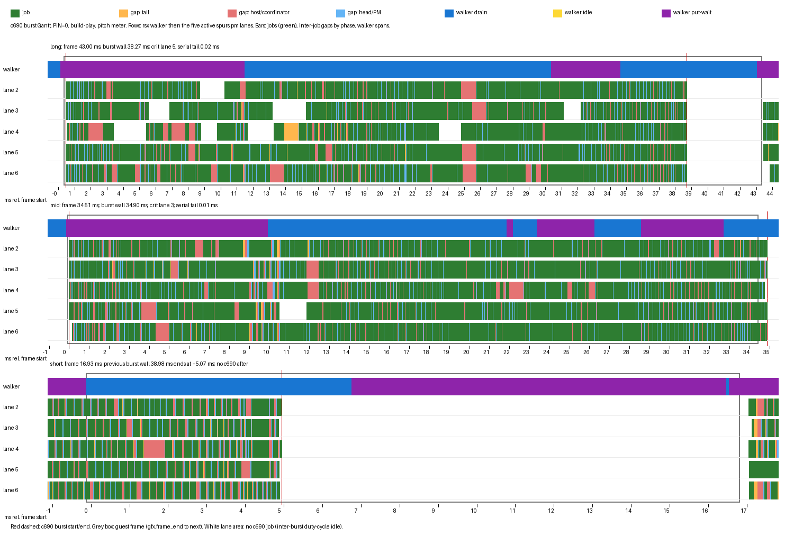

# Thread pinning A/B, and what sets the end of the c690 burst

Date: 2026-11-04. Branch `exp/live-ab` in `ps3recomp-play`, build
`recomp-work/build-play` (`b14617a5`, rebuilt before the runs). Standard
`play_windowed.sh`/`ab_live.sh` configuration (`TEX_DIRTY`, `PIPE_MEMO`,
`REMAP_FAST`, the four cheap wins, the shader disk cache, the hitch recorder,
`SPURS_PM_FAST_RESCHED=8`, WCB=2, CUBE_RT=1, PACE=1) plus `METER=1`,
`SKIP_CINE=1`, `PITCH_THRESH=35`, x11, governor `performance`. Two launches
(`ab_live_pinburst0_20261104_014302`, `ab_live_pinburst1_20261104_014731`):
PIN=0 and PIN=1, each 9 x 10 s at the pitch meter with a 22 s full
`PS3RECOMP_TIMELINE` window (`HITCH_US=0`) armed 2 s after the meter was
confirmed. The first two segments overlap the recorder; the comparison window is
segments 3-8 (60 s).

This follows [`pinning-and-idle.md`](pinning-and-idle.md),
[`frame-timeline-2.md`](frame-timeline-2.md),
[`c690-job-gaps.md`](c690-job-gaps.md) and
[`edge-native-step4.md`](edge-native-step4.md).

## TL;DR

* **`play_windowed.sh` was already PIN=0, but only by omission.** Neither copy
  ever exported `PS3RECOMP_PIN`, and `ab_live.sh` defaults `PIN=0` (it exports
  `PS3RECOMP_PIN=1` only when asked). The recent 35.0-35.4 fps A/Bs were PIN=0;
  the 30.8-32.2 fps runs that used `PIN=1` were the exception. Both
  `play_windowed.sh` copies now set the default explicitly to 0.
* **PIN=0 wins cleanly.** Clean 60 s window: **35.31 fps at PIN=0 vs 30.98 at
  PIN=1** (+4.33 fps, +14.0 %). p50 is identical (34.15 vs 34.16 ms); PIN=1
  loses the p90/p99 tail (39.05/43.48 -> 41.57/47.84 ms), walker drain
  (16.78 -> 17.60 ms) and walker wait (11.17 -> 14.84 ms). PIN=1 also produced
  two presented-frame stalls of 1.58 s and 0.82 s in the measured window
  (PIN=0: one 0.39 s). The earlier run-to-run spread is 0.37 fps for PIN=0 and
  1.37 fps for PIN=1, so the direction is far outside the noise.
* **The burst is not latency-bound and has no serial chain.** For 500 big
  bursts (wall >= 20 ms, mean **35.00 ms**) the critical lane is busy
  **24.39 ms (69.7 %)** and spends **10.61 ms (30.3 %)** in inter-job gaps:
  **tail 2.95 ms (8.4 %)**, **host/coordinator 5.03 ms (14.4 %)**,
  **head/PM 2.56 ms (7.3 %)**. Across all five lanes occupancy is 69.4 %
  (3.47 of 5 lanes busy); the union covers 98.8 % of the wall. Lanes finish
  within **0.17 ms** of each other and the true one-lane tail is **0.02 ms**.
  It is a throughput problem: 70 % job compute plus 30 % per-job dispatch
  turnover, evenly spread over five lanes.
* **No mailbox/DMA/sync wait is on the critical path.** The SPU mailbox,
  signal, event, reservation, out-mailbox and MFC tag wait events emit
  **0 records** in this build/workload; the only SPU wait that fires is
  `PUTLLC` retry, 37.5 k spans of 2.4 us, which cover 87 ms of the 26.4 s of
  gap time (0.3 %). The code re-DMA is a synchronous `memcpy` in the head
  (as in [`c690-job-gaps.md`](c690-job-gaps.md)), not a tag wait. No final
  barrier/sync job: the last job is 49 us at p50 and every lane ends together.
* **Lever ranking (burst wall): fewer gaps > a sixth lane > native stages >
  earlier kick.** Removing the host round trip is worth **5.0 ms**; removing
  all per-lane gaps **10.6 ms** (wall -> 24.4 ms); using a sixth c690 lane
  **5.8 ms** if the workload exposes one; the three biggest native stage
  families at 1.4x **3.2 ms**; the native cull stage alone **~0.3 ms**;
  an earlier kick **0 ms** (the burst already starts 0.25 ms after the frame
  starts). The frame is burst-bound, so a 5 ms burst cut mostly buys p90/p99;
  the 16.9 ms main-ref floor is reached only near a halved burst.

## 1. What the play scripts actually used

`PS3RECOMP_PIN` is read once per process (`thread_affinity.c:init_mapping`);
`PS3RECOMP_PIN_LAYOUT` is live-switchable but PIN on/off is not. The standard
configuration was therefore whatever the environment said.

| script | PIN before this mission | PIN now |
|---|---|---|
| `mlb16-recomp/tools/play_windowed.sh` | no `PS3RECOMP_PIN` export -> 0 | `export PS3RECOMP_PIN="${PS3RECOMP_PIN:-0}"` |
| `recomp-work/play_windowed.sh` | no `PS3RECOMP_PIN` export -> 0 | same line |
| `recomp-work/ab-tools/ab_live.sh` | `PIN=0` default; exports 1 only for `PIN=1` | unchanged |

The line keeps an explicit override possible but makes 0 the default. This
mission did not change `thread_affinity.c`; a live PIN on/off key would have
been a code change, so the two-launch branch of the plan was used.

## 2. PIN A/B

### 2.1 Runs

| launch | tag | PIN | meter | units | timeline |
|---|---|---|---:|---|---|
| 1 | `ab_live_pinburst0_20261104_014302` | 0 | 149 s | 9 x 10 s, 2 s dropped | 22 s, 187 MB |
| 2 | `ab_live_pinburst1_20261104_014731` | 1 | 150 s | 9 x 10 s, 2 s dropped | 22 s, 184 MB |

Both runs had the `[pin]` banner for PIN=1 and no banner for PIN=0. PIN=1 used
the in-code `today` layout: walker cpu 0, ppu main cpu 1, c690 lanes on
2-5,8-11 (the five `spurs pm` lanes plus present/DisplayFlip/kernel share the
same mask).

### 2.2 Frame time (clean segments 3-8, 60 s, 2 s dropped per segment)

| metric | PIN=0 | PIN=1 |
|---|---:|---:|
| frames | 1,695 | 1,487 |
| fps | **35.31** | **30.98** |
| p50 ms | 34.15 | 34.16 |
| p90 ms | **39.05** | 41.57 |
| p99 ms | **43.48** | 47.84 |
| std ms* | 11.43 | 10.67 |
| mean ms | 28.19 | 31.02 |
| walker drain ms | **16.78** | 17.60 |
| walker wait ms | **11.17** | 14.84 |

\* intervals longer than 200 ms are excluded from std only; they are counted
in the fps column. The raw pooled std is 11.41 (PIN=0) and 10.62 (PIN=1); the
PIN=1 run's pooled std in `pin_ab.py` is 38.23 because two 1.58 s / 0.82 s
presented-frame stalls land in the measured window.

Presented-frame gaps (`show_gap`, independent of the fliplog):

| arm | worst measured gaps | present-window note |
|---|---|---|
| PIN=0 | 385.8 ms (segment 6) | its 376 ms window reports 0 drops |
| PIN=1 | **1,581.2 ms** (segment 4), **828.3 ms** (segment 5) | the 956 ms window reports 0 drops; 01:51:10 has 6 no-slot, 206 ms longest present |

The present windows mostly report 0 no-slot / 0 not-ready; the stalls show up
as long `max pump gap` / `vkQueuePresentKHR` values rather than not-ready
drops (PIN=1 01:50:55 window: max pump gap 956 ms, 0 drops; 01:51:10: 6
no-slot, longest present 206 ms. PIN=0 01:46:47: max pump gap 376 ms, 0
drops). They are host present/hand-off stalls, not engine drops. PIN=1 is
much worse, consistent with placing the present and DisplayFlip threads on
the same 2-5,8-11 mask as the five busy lanes.

### 2.3 c690 in the same windows

| metric | PIN=0 | PIN=1 |
|---|---:|---:|
| big bursts (>=20 ms) | 500 | 491 |
| burst wall mean ms | **35.00** | 35.83 |
| burst wall p50 / p90 ms | 34.94 / 37.72* | 35.45 / 39.43* |
| c690 union per frame mean ms | 23.21 | 24.16 |
| c690 lane jobs/s (5 lanes) | **3,076** | 2,902 |
| host share of inter-job gap | 48.2 % | 51.9 % |

\* pooled per-mark window from `tl_c690.py`: 34.37 / 37.64 (PIN=0) and
35.14 / 38.91 (PIN=1); the whole-22 s table is 35.00 and 35.83 ms. The
difference is windowing, not a different definition.

The burst wall moves only 0.8 ms (2.3 %) while the frame moves 4.3 fps
(14 %), so the PIN difference is not c690 job compute. It is scheduling:
PIN=0 lets the OS keep the walker, present and the lanes from colliding on the
same six logical CPUs, and the coordinator host phase is 3.7 points shorter.

### 2.4 Run-to-run spread from earlier baselines

| arm | earlier clean-window fps | this run | spread |
|---|---|---:|---:|
| PIN=0 | 34.98 (`screenab` A), 35.17 (`screenmap` A), 35.35 (`cullab` A) | 35.31 | 0.37 fps (1.1 %) |
| PIN=1, `today` | 30.82 (`pin2a` A), 31.33/31.40 (`pin2b` A/B), 32.19/32.12 (`walk2b` A/B) | 30.98 | 1.37 fps (4.4 %) |

The PIN=1 numbers span the pre-remap and post-remap builds; even its best
earlier value (32.19) is 2.8 fps below PIN=0's worst (34.98). **PIN=0 wins.**

## 3. Burst reconstruction method

The timeline is a `PSTL` binary stream. The analyser keeps the spans
`PS3_TR_C690_JOB` (`ev 33`, LS `0x135B8..0x12AB8`), `PS3_TR_SPU_POLICY`
(`ev 4`), `PS3_TR_RSX_DRAIN` (`13`), `PS3_TR_RSX_IDLE_WAIT` (`43`),
`PS3_TR_RSX_PUT_WAIT` (`15`) and the wait spans; guest milliseconds are
anchored on the newest `[flip]`/`[fliplog]` pair.

* **Lane** is the `spurs pm` host thread that runs c690 jobs. There are five:
  tids 2-6 in the PIN=0 run (2,3,4,5,7 in the PIN=1 run, because pinning
  changes the boot thread's name/tid assignment). The sixth `spurs pm` worker
  runs the policy module only and has no c690 jobs.
* **Burst** is the union of all five lanes' job spans, split where the next
  job starts more than 1 ms after the previous union end. This is the same
  definition as [`frame-timeline-2.md`](frame-timeline-2.md); "big" is
  wall >= 20 ms.
* **Gap phases** reuse the `c690-job-gaps.md` model: for consecutive jobs on
  one lane, `tail = policy_end - job_end`, `host = next_policy_start -
  policy_end`, `head = next_job_start - next_policy_start`, with the policy
  span that contains each job. Phases are scaled down only if they exceed the
  measured gap.
* **Wait attribution** sums the overlap of the gap with each SPU wait span on
  the same lane. In this build `SPU_MBOX_WAIT`, `SIGNAL_WAIT`, `EVENT_WAIT`,
  `RESV_WAIT`, `OUT_MBOX_WAIT` and `TAG_WAIT` emit no records, so only
  `LOCKLINE_RETRY` is available; the phase split above is the authoritative
  decomposition (as stated in `c690-job-gaps.md` §2).

The scripts and the per-frame JSON are in the two run folders;
`analyze_burst.py`, `burst_extra.py` and `make_gantt.py` reproduce the tables
and the figure. The 22 s timelines are 187 MB and 184 MB, well under the 1 GB
cap; they are not required to rebuild the summary.

## 4. What sets the end of the burst

### 4.1 Whole-window burst statistics (PIN=0)

| quantity | mean | p50 |
|---|---:|---:|
| burst wall (big, n=500) | 35.00 ms | 34.94 ms |
| any-lane union | 34.58 ms (98.8 % of wall) | - |
| per-lane busy | 24.17 / 24.15 / 24.29 / 24.33 / 24.50 ms | - |
| jobs per lane | 134.6 / 135.9 / 136.6 / 136.0 / 137.4 | - |
| job duration | 178.4 us | 131.7 us |
| critical-lane busy | **24.39 ms (69.7 %)** | - |
| critical-lane gap | **10.61 ms (30.3 %)** | - |

The five lanes carry the same work within 1.4 % (24.15-24.50 ms of busy time
per burst). The burst wall is not set by one long job or one lane: the
first-to-last lane finish stagger is **0.173 ms mean (p50 0.089 ms)** and
the interval with only one lane still running is **0.021 ms mean**. The last
job on the critical lane is **73 us mean, 49 us p50**; there is no final
barrier or long sync job. Every traced c690 job reports the same descriptor
value `0x1330`, so the trace cannot label job type; the critical job is
identified by lane and time, not by its descriptor.

Lane concurrency inside a big burst (ms of the 35.0 ms wall, time-weighted):

| lanes busy | 0 | 1 | 2 | 3 | 4 | 5 |
|---|---:|---:|---:|---:|---:|---:|
| ms | 0.42 | 1.71 | 4.87 | 9.30 | 11.40 | 7.30 |

Mean **3.47 of 5 lanes busy**. The union covers 98.8 % of the wall, so some
lane is almost always running; the idle is distributed as tiny per-job gaps,
not as a global stall.

### 4.2 The four fractions of the burst wall

| fraction | share of burst wall | evidence |
|---|---:|---|
| (a) job compute | **69.7 %** | critical lane busy 24.39 of 35.00 ms; all-lane occupancy 69.4 % |
| (b) inter-job gaps | **30.3 %** | 10.61 ms on the critical lane; 30.2 % of all lane-time |
| (c) waiting on the PPU or walker | **~0 %** inside the burst | no wait span covers the empty-lane time; the burst starts 0.25 ms after the frame starts and the walker tail is outside it |
| (d) serial tail (one lane while others idle) | **0.1 %** | 0.021 ms mean second-last-to-last finish; 0.173 ms full stagger |

Gap breakdown on the critical lane: **tail 2.95 ms (27.8 % of the gap)**,
**host 5.03 ms (47.4 %)**, **head 2.56 ms (24.1 %)**; pooled over all lanes
the shares are 27.8 / 48.2 / 24.0 %. The host
phase is the SPURS worker -> coordinator -> worker round trip; the tail is
the job's submit epilogue plus the PM exit; the head is the PM's ticket and
descriptor staging plus the synchronous code re-DMA. The wait events that do
fire are negligible: `LOCKLINE_RETRY` is 87 ms inside 26.4 s of gap time
(0.3 %), and the mailbox/tag events are absent.

So the premise that the burst is latency-bound by a serial chain, a dependency
or a wait is **not supported**. It is bounded by five balanced lanes doing
70 % compute and 30 % per-job dispatch turnover; the end of the burst is
simply the last ~50 us job of the lane that happened to have one extra job.

### 4.3 The frame around the burst

762 frames in the 22 s window: p50 **34.15 ms**, p90 40.07, p99 44.17, mean
28.85. 669 frames contain a >= 20 ms burst; 89 frames contain no c690 work at
all (the 16.9 ms main-ref cycle). A big burst starts **0.23-0.25 ms** after
the frame start in mid/long frames; when the burst fits inside the frame the
frame ends 0-4.7 ms after its last job (the mid frame's burst spills past its
end). The frame is the burst plus a small walker/present tail.

Representative frames (the figure):

| frame | length | burst | what it shows |
|---|---:|---:|---|
| long | 43.00 ms | 38.27 ms | all five lanes solid to ~39 ms, then ~4 ms walker/present tail; critical lane 5; serial tail 0.02 ms |
| mid | 34.51 ms | 34.90 ms | burst starts 0.1 ms in and spills past the frame end; critical lane 3 |
| short | 16.93 ms | tail of 38.98 ms burst | the previous burst's last jobs end at +5 ms; no c690 work for the rest of the 16.9 ms frame (inter-burst duty cycle) |



Rows are the `rsx walker` and the five `spurs pm` lanes. Green is a job;
orange/red/blue are the tail, host and head parts of the inter-job gaps. The
walker row shows drain (blue), idle (yellow) and `put_wait` (purple); on the
long frame the walker drains and put-waits while the burst is still running.

## 5. Levers, with ms estimates

Basis: critical-lane busy 24.39 ms and gap 10.61 ms inside a 35.00 ms big
burst; all-lane busy 121.4 ms. Stage shares from the c690 profile
(unpack/pack 23.5 %, skin/transform 13.6 %, normalize 8.2 %).

| lever | estimate | how |
|---|---:|---|
| remove the host round trip (perfect fast reschedule) | **-5.0 ms** (-14.4 %) | critical-lane host phase 5.03 ms; wall -> 30.0 ms |
| remove every per-lane gap (perfect packing, same 5 lanes) | **-10.6 ms** (-30.3 %) | all 10.61 ms on the critical lane; wall -> 24.4 ms |
| add a sixth c690 lane | **-5.8 ms** (-16.6 %) | per-lane busy and job count scale 5/6: 24.4 -> 20.3 ms, gap 10.6 -> 8.8 ms; only if the workload exposes a 6th independent lane (`SPURS_LANE6`) |
| native unpack/pack + skin/transform + normalize at 1.4x | **-3.2 ms** (-9.0 %) | 24.39 x 0.453 x (1 - 1/1.4); 1.53x gives -3.8 ms |
| all job compute at 1.3x / 1.53x | -5.6 / -8.5 ms | 24.39 x (1 - 1/f) |
| native cull only (0xFDA0 1.3x + 0xD080 1.53x) | **-0.3 ms** | ~7.9 us saved per cull at ~1,000 culls/s, ~35 culls per 35 ms burst on each lane |
| earlier PPU kick | **0 ms** of burst wall | the burst already starts 0.25 ms after the frame start; at most the 1.6-4.7 ms non-c690 tail if the producer could run one frame ahead |

Ranking: **scheduling gaps first, a sixth lane second, native stages third.**
This matches the live result in [`edge-native-step4.md`](edge-native-step4.md):
the native stages are real 1.3-1.53x per call but only cover a small slice of
the 24.4 ms of lane compute, so the frame does not move.

Frame-level: p50 is 34.15 ms with the burst sitting on the 34-35 ms mode.
The `frame-timeline-2.md` per-frame scaling predicts p50 27.0 ms at a 0.8x
burst, 23.1 ms at 0.69x and 16.9 ms at 0.5x. So a 5 ms gap cut should mostly
reduce p90/p99 (and the present stalls), not p50; reaching the ~17 ms
main-ref floor needs the burst cut by about half, i.e. the gap and sixth-lane
levers together, plus some native job time.

## 6. Changes kept

* `mlb16-recomp/tools/play_windowed.sh` and `recomp-work/play_windowed.sh`
  now set `export PS3RECOMP_PIN="${PS3RECOMP_PIN:-0}"` explicitly. Nothing
  else changed; no C code and no `exp/live-ab` commit.
* `ab_live.sh` is unchanged (its `PIN=0` default was already correct).

## 7. Reproduce

```sh
cd /home/m/Documents/mlb16-online/recomp-work/ab-tools
# one launch per arm; kill the trigger if a previous run left it behind
rm -f /tmp/pin0.bin /tmp/pin0.go
( for i in $(seq 1 600); do f=$(ls -t ../ab_live_pinburst0_*.log 2>/dev/null | head -1);
    [ -n "$f" ] && grep -q "pitch meter confirmed" "$f" && { sleep 2; touch /tmp/pin0.go; break; }
    sleep 1; done ) &
TAG=pinburst0 PIN=0 N=9 SEG=10 DROP=2 METER=1 SKIP_CINE=1 WCB=2 \
  VIDEODRIVER=x11 REPORT=0 LIMIT=700 SETTLE=10 PITCH_THRESH=35 \
  ARMS='A=' BOOT_ARM='' \
  PS3RECOMP_TIMELINE=/tmp/pin0.bin \
  PS3RECOMP_TIMELINE_TRIGGER=/tmp/pin0.go \
  PS3RECOMP_TIMELINE_SECS=22 PS3RECOMP_TIMELINE_RING_MB=64 \
  PS3RECOMP_TIMELINE_FLUSH_MB=16 PS3RECOMP_TIMELINE_HITCH_US=0 \
  ./ab_live.sh
# repeat with TAG=pinburst1 PIN=1 and /tmp/pin1.*

python3 pin_ab.py --log ../ab_live_pinburst0_*.log \
  --marks ../ab_live_pinburst0_*.marks --seg 10 --drop 2
python3 pin_ab.py --log ../ab_live_pinburst1_*.log \
  --marks ../ab_live_pinburst1_*.marks --seg 10 --drop 2

# burst analysis and figure (scripts are in the run folders)
cd ../ab_live_pinburst0_20261104_014302
python3 analyze_burst.py /tmp/pin0.bin ../ab_live_pinburst0_*.log \
  ../ab_live_pinburst0_*.marks burst0.json burst0.txt
python3 burst_extra.py /tmp/pin0.bin ../ab_live_pinburst0_*.log burst0.json
python3 tl_c690.py /tmp/pin0.bin ../ab_live_pinburst0_*.log \
  ../ab_live_pinburst0_*.marks 10 2
python3 make_gantt.py /tmp/pin0.bin ../ab_live_pinburst0_*.log \
  burst0.json burst_gantt.png
```

## 8. Deviations and caveats

* **The burst-critical-path premise was partly wrong.** It is not a serial
  chain, a dependency or a mailbox/DMA wait; 30 % of the wall is per-job
  dispatch turnover evenly spread over five lanes, and 70 % is compute. The
  report answers the question with that finding rather than forcing a serial
  tail.
* **PIN on/off cannot be changed live in this build.** `PS3RECOMP_PIN` is
  read once; only `PS3RECOMP_PIN_LAYOUT` is live. Per the plan, two launches
  were used (no interleaving). The run-to-run spread above is the guard.
* **The timeline recorder was on in both launches, not just the burst run.**
  It was needed for the per-arm burst wall. The 60 s comparison window is
  segments 3-8, outside the 22 s window, so the recorder overhead does not
  enter the fps comparison. The prior overhead check was +0.03 ms p50 /
  +0.67 ms mean.
* **PIN=1 has two large presented-frame stalls in its measured window**
  (1.58 s, 0.82 s) and PIN=0 has one 0.39 s stall. They appear as long
  `max pump gap` values, not as not-ready drops (the 01:51:10 window is the
  exception: 6 no-slot drops, 206 ms longest present). The fps column counts
  them and the std column excludes intervals > 200 ms. The p50/p90/p99 and
  walker evidence is unaffected.
* **SPU wait events are not emitted** in this build (0 records for mailbox,
  signal, event, reservation, out-mailbox and tag waits). The gap phase split
  uses policy spans, as `c690-job-gaps.md` does, and `LOCKLINE_RETRY` is the
  only measurable SPU wait.
* **The traced job descriptor is constant** (`0x1330`) for every c690 job,
  so the last job cannot be named by type; the critical lane and its last
  jobs are identified by thread and time instead.
* **One meter window per arm, one scene.** The pitch meter is stable, but
  the present stalls and the scene's 16.9 ms main-ref cycle still shape the
  distribution. Multi-scene checks remain the user's windowed runs.

## 9. Clean room

This is our own reverse engineering of the game's c690 job module, the
captured LS/GPR pairs and the runtime's trace stream. The stage-split/corpus
method follows NHL Legacy Native (MIT, (c) 2026 HeckYouMan) with attribution;
no NHL code was copied. No RPCS3 or other GPL emulator source was read or
cited.
