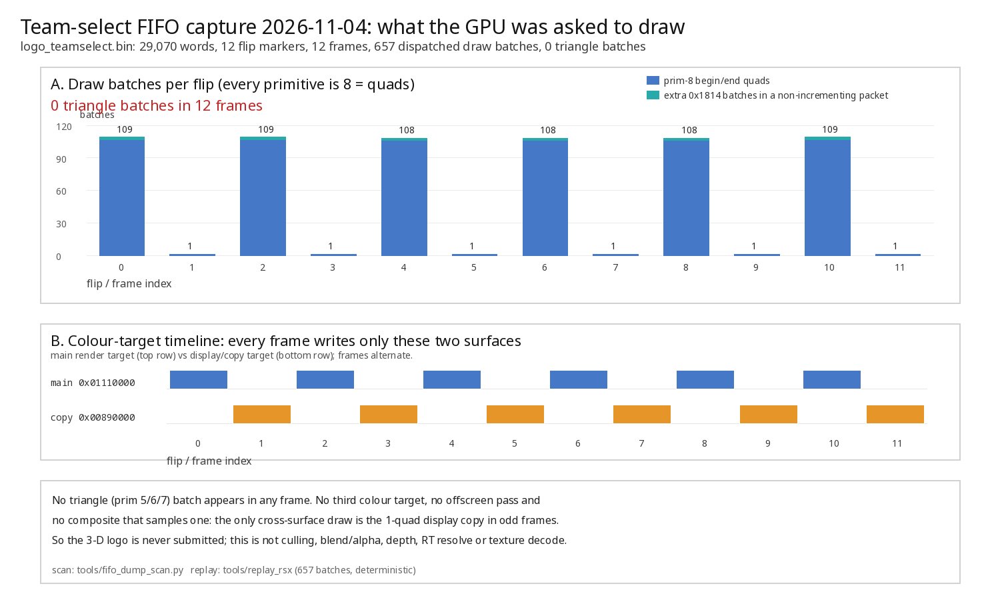

# Team-select 3D logo: capture trigger, static map, and the replay plan

Date: 2026-11-04. **No game was launched** (AGENTS.md: automated runs measure
only the pitch; the user drives team select). Sources: the EBOOT in Ghidra, the
runtime on `exp/live-ab` in `ps3recomp-play`, and the earlier notes in
`team-select-and-logos.md`, `boot-spu-hitches.md` (§3), `tick-and-resync.md`,
`textures-dummy-census.md`, `visuals-wcb-gamma.md`. No GPL emulator source was
read.

Branch `exp/live-ab`, build `recomp-work/build-play`. The old jump-park/resync
theory is **disproved** for this symptom: the 600 s-grace run had zero `FIFO
resync` lines and zero `gcm.resync` events (`boot-spu-hitches.md` §3), so this
document starts from "the logo draw is not submitted, or is submitted but not
visible", and prepares the capture that settles which.

## TL;DR

| # | Question | Answer |
|---|---|---|
| 1 | Can a FIFO dump be placed at a scene the user navigates to? | Not before this change: `PS3RECOMP_DUMP_FIFO` opened on the first drain and only `PS3RECOMP_DUMP_FIFO_SKIP` (a flip count known at launch) could reach a later screen. A live trigger was added (below), default off. |
| 2 | What is `FUN_000f56f4` case 2? | A string resolver: it `snprintf`s `"logos\\logo3d_<TEAM>"` and returns a UI string. It opens no file, binds no model, submits no draw/RT/SPU job. |
| 3 | What is `UI_InGame3DTeamLogo` at `0x00fb0860`? | It is the **string** `"UI_InGame3DTeamLogo"`, not a function. Its only code user, `.opd.FUN_00510130` (`0x00510130`), uses it to pick a camera transition (`"Camera_Trans_0%d"`). It does not render the logo. |
| 4 | What actually draws the floating logo? | A `ScriptUIElem`/`ScriptModel` (UI element) whose scene is rendered by `.opd.FUN_009d611c` → `FUN_009d5c08` → `FUN_009d53bc` → `FUN_006bd388`/`FUN_006bde60`; the element is composited as a 2D textured quad. On the type-5/7 path it first renders into `ScriptUIElem_RT` and copies that back into the element texture. |
| 5 | Most likely causes, in order | (1) element/model never submitted, (2) offscreen RT or RT→texture copy never composited, (3) draw submitted but killed by state/texture handling in our engine, (4) camera/visibility transform, (5) name/model-load hand-off. |

> **Capture result (2026-11-04):** the capture answers the first question.
> All 12 flips contain only primitive-8 quads; there is **no triangle batch
> and no offscreen render-target pass** in the whole stream. The 3-D logo is
> never submitted, so the loss is upstream of the RSX draw path (§5.6). The
> capture is valid and complete; only the optional walker `.fifo` missed the
> full UI frame.

## 1. The capture the user runs

### 1.1 What was added

`libs/video/cellGcmSys.c` gained an **armed** mode for the existing FIFO dump:

| Variable | Meaning |
|---|---|
| `PS3RECOMP_DUMP_FIFO=<path>` | output file (unchanged). Unset/empty = completely inert. |
| `PS3RECOMP_DUMP_FIFO_FRAMES=<n>` | flips to record (default 100, unchanged). |
| `PS3RECOMP_DUMP_FIFO_SKIP=<n>` | flips to drop first (default 0, unchanged; legacy mode only). |
| `PS3RECOMP_DUMP_FIFO_ARM=1` | **new**: do not open at boot. Wait for a trigger. |
| `PS3RECOMP_DUMP_FIFO_TRIGGER=1` | **new**: live switch (in the `PS3RECOMP_CTL` file, name table `PS3_LIVE_DUMP_FIFO_TRIGGER`). A rising edge starts the dump at the next flip boundary. |

Without `ARM` the old boot-time behaviour is byte-for-byte unchanged. With
`ARM`, no file is created until the trigger, and the dump then holds exactly
`FRAMES` complete frames (the flip after the trigger closes the prior frame and
is not written). The trigger is level-detected, so a held `1` does not restart
the dump; write `0` (or remove the file) and raise it again for a second one.

The offline fixture `libs/video/tests/test_gcm_fifo_dump_trigger.c` compiles
`cellGcmSys.c` in and links the real `ps3_live_ctl.c`; it checks: armed waits,
no trigger = no file, control-file write starts at a flip boundary, exactly two
frames, held trigger does not re-arm, and the payload is big-endian method
words ending in `0xFEAD0000|buffer`. Run it with
`python3 tools/test_gcm_fifo_dump_trigger.py` (PASS, 8/8).

### 1.2 One-line launch for the user

Run from anywhere; the script uses absolute paths. `rm -f` first so a stale
control file cannot fire at boot.

```sh
rm -f /tmp/logo.ctl /tmp/logo_cap.trigger && cd /home/m/Documents/mlb16-online/recomp-work && PS3RECOMP_CTL=/tmp/logo.ctl PS3RECOMP_DUMP_FIFO=/tmp/logo_teamselect.bin PS3RECOMP_DUMP_FIFO_FRAMES=12 PS3RECOMP_DUMP_FIFO_ARM=1 PS3RECOMP_WALKER_CAPTURE=/tmp/logo_cap ../mlb16-recomp/tools/play_windowed.sh
```

Then, in the game:

1. Go to the team-select screen and let it settle for about 5 s (the floating
   3-D logo should be on screen; the 2-D crests and the `AT` panel are the
   reference).
2. Run this **one trigger line** in another terminal:

   ```sh
   rm -f /tmp/logo.ctl; echo 'PS3RECOMP_DUMP_FIFO_TRIGGER=1' > /tmp/logo.ctl; touch /tmp/logo_cap.trigger
   ```

   The first two parts start the 12-frame FIFO dump at the next flip
   (`/tmp/logo_teamselect.bin`). The `touch` is optional and captures one
   frame with guest memory (`/tmp/logo_cap.fifo/.state/.mem`) for the deeper
   per-draw pass in §5.3.
3. Wait ~1 s, close the window (or Ctrl-C). The log prints
   `[cellGcmSys] FIFO dump armed ...`, then `FIFO dump trigger seen`, then
   `FIFO dump closed: N words written`; `[walker-cap] frame complete` follows
   for the optional capture.

Do not use a `SKIP` frame count with this run; the trigger replaces it. The
standard `play_windowed.sh` defaults are unchanged. Nothing here changes the
scene the user drives or any renderer switch.

### 1.3 Capture format (what the next mission reads)

`PS3RECOMP_DUMP_FIFO` is **raw, big-endian 32-bit method words**, no header:
method headers (`type = w >> 29` normally 0 or 2) followed by their data
words, plus a `0xFEAD0000 | buffer` marker at each flip. JUMP/CALL/RET and
NOPs are not written; the stream is linear and branch-free. `tools/replay_rsx`
accepts it directly (raw fallback), and also accepts the optional `RSXF`
header form used by `PS3RECOMP_WALKER_CAPTURE` (`<prefix>.fifo`, native
little-endian 32-byte header + big-endian payload). The walker capture adds
`.state` (register/VP/constant snapshot) and `.mem` (guest pages actually read)
for `tools/replay_rsx_engine`.

## 2. What the static path actually does

### 2.1 `FUN_000f56f4` case 2: a string, not a draw

Decompiled at `0x000f56f4`, case `iVar4 == 2` (`0x000f58a8`):

```c
iVar4 = _opd_FUN_0001e1e0();                       /* returns 1 */
if (iVar4 != 0 && 1 < param_3 && arg_blob[1] != NULL) {
    iVar4 = *(int*)arg_blob[1];
    if (0 <= iVar4 && iVar4 < 0x8a)
        FUN_00a402f8(buf, 0xff, "logos\\%s",
                     (&PTR_s_logo3d_BAL_01177574)[iVar4]);
    FUN_009a0fb4(param_4, 0, buf);                  /* UI string result */
}
```

The format string is at `0x00f405e4`; the name table starts at `0x01177574`
(entries point at `0x01011c7c`: `logo3d_BAL`, `logo3d_BOS`, …). It is invoked
from `.opd.FUN_00297b60` (`0x002982d4`) through the frontend UI-script opcode
table. There is **no** model load, WAD read, SPU job, render target or draw in
this function; if the script table entry is unpatched, the result is an empty
string. Whether a `ScriptModel`/`ScriptUIElem` consumes that string is script
side, not in the EBOOT (uncertain, but it is the hand-off to check if the FIFO
has no model draw).

### 2.2 `UI_InGame3DTeamLogo`: a state name, not a renderer

`0x00fb0860` reads `"UI_InGame3DTeamLogo"` (64-byte read confirms the string
and the following `"Camera_Trans_0%d"`). Its only xref is `.opd.FUN_00510130`
(`0x00510130`, code use at `0x005101e4`), which compares the current UI state
name against `UI_InGameRandom*`, `UI_InGame3DTeamLogo`, then stores a
`"Camera_Trans_0%d"` transition name. A wrong/missing camera transition can
move a rendered logo off-screen, but this function submits nothing.

### 2.3 The visible logo is a `ScriptUIElem`

* `ScriptUIElem::Render` is `.opd.FUN_009d611c` (`0x009d611c`), a state machine
  (`vtable+0x28` read, `+0x2c` set). Its early-outs: global
  `DAT_013561d8 != 0` (`DisableUIElem`), `DAT_011409a8 == 0` (alloc failure),
  `DAT_011409a8+0x1f4 != 0`, `elem+0x10 == 0` (element texture null),
  `elem+0xc == 0` (element model object null), `((int*)elem+0xc)[3] == 0`.
* State 1 (`0x009d642c`) creates `DAT_0115e920 = FUN_004b8f04("ScriptUIElem_RT",
  w, h, tile, 2, 0x20, 0x14008)` **only for scene/texture node types 5 or 7**;
  scissor via `FUN_004b92cc`, then `FUN_009d5c08` (`0x009d5c08`) renders the
  scene into it.
* State 2 (`0x009d66bc`) is a second `FUN_009d5c08` pass; state 3
  (`0x009d6a3c`) draws the offscreen RT as a textured quad
  (`FUN_004c6ac0`/`FUN_00895128`); state 4 (`0x009d6b14`) copies the RT into
  the element texture with `FUN_009e2048`, unregisters `"UIElem_Thumbprint"`,
  frees the RT (`FUN_004b8678`) and finishes the 2D element draw.
* The normal visible path (types ≠ 5/7) renders with `FUN_009d5c08` into the
  element's own texture (`elem+0x10`) and always composites as a 2D quad
  (`FUN_009d4a78`, `FUN_006a0e48`/`FUN_006a1048`). So even the "3D" logo is an
  offscreen scene plus a 2D composite, not a direct framebuffer draw.
* Scene render: `FUN_009d5c08` logs `"RenderUI() Nm: %s An:%s"`, bails if
  `DAT_013561e0 != 0`, then calls `FUN_009d53bc` (`0x009d53bc`), which draws
  with `FUN_006bd388` (node mask `model+0x1ec & 4`) and `FUN_006bde60`
  (`& 8`) using either the element target (`elem+0x398`) or the default camera
  `&DAT_01120000`.
* Model load/bind: `ScriptModel` path `.opd.FUN_009cd1ac` (`0x009cd1ac`) →
  `FUN_009b5578` (`0x009b5578`, probes `"%s.%d"` chunks, materials under
  `$(PLATFORM)/Stadiums/MaterialDatabase/`) → `FUN_004c345c`/`FUN_004c1c28` →
  `FUN_004c220c` (`Model::Bind`). Element creation is `FUN_009d7b30`
  (`0x009d7b30`) → `FUN_009d4c68` (target texture lookup in the `"world"`
  scene; failure text `"Did not find target texture: %s"`) and
  `FUN_00edd244` (asset path via `FUN_006b8c30`/`FUN_006be8e8`).
* RT plumbing: `FUN_004b8f04` → `FUN_004b8ae4` → `FUN_004de4cc`; region
  `FUN_004b92cc` → `FUN_004db8e0`; pass begin/end `FUN_004b4d40` /
  `FUN_004b5268` (the latter ends with `gcm_SetDrawArrays(..., 8, ...)`).
  Guest tile/zcull wrappers are `FUN_0006dfb4` (SetTileInfo+BindTile),
  `FUN_0006e0a0` (UnbindTile), `FUN_0006e0c8` (BindZcull) and `FUN_0006e264`
  (UnbindZcull); the CPU-side RT→texture copy is `FUN_009e2048`.

### 2.4 FIFO signature of the 3D model

The game writes raw FIFO words itself (no `cellGcmSetDraw*` imports). The mesh
draw is emitted by `FUN_004d9084` (`0x004d9084`):

* arrays: `gcm_SetDrawArrays(ctx, 5, count, count)` (`0x004d9110`);
* indexed: `gcm_SetDrawIndexArray(ctx, 5, count, count, 0x10, off, 1)`
  (`0x004d912c`). Primitive `5` = triangles, `0x10` = 16-bit indices.

The corresponding FIFO methods are `0x1808` (BEGIN_END; data 5 = triangles,
0 = end), `0x1814` (vertex batch, first/count in the header), `0x1824` (index
batch), `0x1818` (inline vertex data), `0x181C`/`0x1820` (index offset/format),
`0x1714` (inline array), textures `0x1A00+unit*0x20` (`+0x04` format, `+0x0C`
control0 enable bit 31, `+0x18` NPOT size), surface `0x0210` colour offset /
`0x0214` zeta offset / `0x0208` format, depth `0x0A74`/`0x0A6C`/`0x0A70`,
blend `0x0310`/`0x0314`/`0x0318`/`0x0320`, cull `0x183C`/`0x1830`. The 2D UI
layer ends each pass with primitive `8` (quads, `FUN_004b5268` at
`0x004b52bc`), which is the easy discriminator from the 3D mesh.

## 3. Hypotheses, ranked, with the check each needs

The capture check refers to `/tmp/logo_teamselect.bin` (§1) unless stated.

| # | Hypothesis | Why plausible | Check in the capture | If confirmed |
|---:|---|---|---|---|
| 1 | **The element/model is never submitted** (null model, missing scene/target, `DisableUIElem`, an early-out in `FUN_009d611c`, or the `logo3d_*` name never reaches a `ScriptModel`) | The whole EBOOT path above can skip without any file error; a missing model is a silent early-out. | `tools/fifo_dump_scan.py /tmp/logo_teamselect.bin --draws --prim 5`: **no** triangle batches `0x1814`/`0x1824` and only primitive-8 quads; compare with the 2D crest draws. Also `grep -n 'did not find target\\|Model::Bind\\|logo3d'` in the run log if those debug strings are enabled. | Static: trace the script hand-off and `FUN_009b5578`/`FUN_004c220c`; add a log at element creation. |
| 2 | **Offscreen RT / RT→texture copy is not composited** (the element renders into `ScriptUIElem_RT` or its own texture, and the 2D quad samples stale/empty memory) | The visible logo is an offscreen scene plus a quad composite (`FUN_009d5c08`/`FUN_009d53bc`/`FUN_009d4a78`); `FUN_009e2048` copies tile-by-tile and returns silently on a format/size mismatch. | Triangle draws are present **and** `0x0210` (colour target) changes to an offscreen offset before them; the following primitive-8 quad binds that texture (`0x1A00`). Look for the `0x1A00`/`0x1A04` offset/format of the composite and whether it follows the RT offset. | Check our RT/tile/zcull and texture-resolve path; try `PS3RECOMP_RSX_WCB=0` / `=3` and `PS3RECOMP_ENG_TEXHASH_FULL=1` on the same scene. |
| 3 | **Draw submitted but invisible in our engine** (depth/stencil/cull/blend, texture format/swizzle, wrong pipeline, primitive dropped) | `rsx.draw_submit` only counts batches today, and the earlier frame is otherwise healthy. | Triangle batches are present in the dump; `replay_rsx` counts them. Around them, read `0x0208` format, `0x0A74`/`0x0A70`, `0x183C`, `0x0310`, and the `0x1A04` texture format. | Bisect with `PS3RECOMP_ENG_TEXMEMO=0`, `PS3RECOMP_ENG_TEXHASH_FULL=1`, `PS3RECOMP_ENG_DEPTH_VIA_GUEST=1`, `GCM_SEMA_ACQUIRE=1`; then add a per-draw drop reason if none moves it. |
| 4 | **Camera/visibility transform** (logo drawn off-screen, node mask, `UI_InGame3DTeamLogo` transition camera) | `FUN_009d53bc` falls back to the default camera if `elem+0x295` does not resolve, and `FUN_006bd388`/`FUN_006bde60` skip on node-mask bits. | Triangle draws are present but with viewport/scissor/transform constants unlike the neighbouring UI; `0x0A20`-range transform constants and the viewport/scissor methods (`0x0A0C`/`0x08C0`). | Compare matrices with a working 3-D element; check `DAT_013561d8`/node masks. |
| 5 | **Name/model hand-off** (runtime-patched selector table at `0x01126600`, or the script property never filled) | `FUN_000f56f4` case 2 emits the name through a table whose in-file entries look zero-keyed; if the table is not registered, the result stays empty. | Same as #1 (no model draw). The capture cannot see the selector; use the title's own debug prints or `Model::Bind` logging. | Static: check the table registration at runtime; log the `logos\\logo3d_*` result. |
| 6 | **Mesh/SPU job ordering** (geometry not ready when the draw executes) | The Gfx path uses guest threads, labels/semaphores and `cellSpurs`; our `ACQUIRE` is a no-op by default. | Semaphore methods `0x64/0x68/0x6C` and `GCM_SEMA_ACQUIRE` labels around the draw; SPU workload activity at the same time. | Try `GCM_SEMA_ACQUIRE=1 GCM_SEMA_ACQUIRE_MS=1000`; if it wedges, bound the wait. |

The earlier census already rules out a general texture/dummy/WCB fault on the
team frame (`textures-dummy-census.md`, `visuals-wcb-gamma.md`), which is why
#1/#2 are ahead of #3.

## 4. Switch reference (real names, defaults)

| Doc shorthand | Real variable | Default | What it really does |
|---|---|---|---|
| `ENG_TEXMEMO` | `PS3RECOMP_ENG_TEXMEMO` | **on** (only `=0` disables) | per-frame texture binding memo (`rsx_draw_engine.c:6914`) |
| `ENG_TEXHASH_FULL` | `PS3RECOMP_ENG_TEXHASH_FULL` | off | force a full texture hash every frame instead of every 8 (`:6905`, `:2426`) |
| `ENG_FSBIND_ALL` | `PS3RECOMP_ENG_FSBIND_ALL` | off | **logging only**: widens `PS3RECOMP_ENG_FSBIND_LOG` to full-screen draws; needs `PS3RECOMP_ENG_FSBIND_LOG=<n>` (`:5337-5357`) |
| `ENG_DEPTH_VIA_GUEST` | `PS3RECOMP_ENG_DEPTH_VIA_GUEST` | off | read depth targets through guest memory instead of the backend conversion (`:6907`, `:2295`) |
| `GCM_SEMA_ACQUIRE` | `GCM_SEMA_ACQUIRE` (no prefix) | 0 | make `ACQUIRE` block; bound with `GCM_SEMA_ACQUIRE_MS` (`cellGcmSys.c:3387-3412`) |
| WCB | `PS3RECOMP_RSX_WCB` | 2 | readback/resolve mode; `0` off, `3` async (`play_windowed.sh`) |
| cube RT | `PS3RECOMP_RSX_CUBE_RT` | on in `play_windowed.sh` | assemble cube render targets on the GPU (`rsx_draw_engine.c:2561`) |

`PS3RECOMP_ENG_FSBIND_ALL` alone produces no output; do not treat an empty log
as evidence. `GCM_SEMA_ACQUIRE=1` without a bound can wedge the drain, so use
`GCM_SEMA_ACQUIRE_MS` when trying it live.

## 5. Offline replay plan (next mission, on the user's capture)

### 5.1 Build the tools (no game launch)

```sh
cd /home/m/Documents/mlb16-online/recomp-work/build-play
ninja ps3recomp_sdk/replay_rsx ps3recomp_sdk/replay_rsx_engine
```

`replay_rsx` needed six newer draw-engine no-op stubs in
`tools/replay_rsx_core.c` to link on this branch; that is fixed. It is a
dispatch/register-file replay, not a renderer: it prints draws/clears/flips,
a whole-stream state hash and timing, and **does not emit a per-draw list**.

### 5.2 First question: are the logo's draws in the stream at all?

Use the scanner (works on raw `.bin` and `RSXF` `.fifo`; it splits at
`0xFEAD0000` markers and follows the walker's header count rule):

```sh
cd /home/m/Documents/mlb16-online
python3 ps3recomp-play/tools/fifo_dump_scan.py /tmp/logo_teamselect.bin --top 30
python3 ps3recomp-play/tools/fifo_dump_scan.py /tmp/logo_teamselect.bin --draws --prim 5
python3 ps3recomp-play/tools/fifo_dump_scan.py /tmp/logo_teamselect.bin --draws | head -200
```

Interpretation:

* Per frame, team select is roughly 55 draws in the earlier censuses; the 2-D
  UI is primitive 8. If **no primitive-5 batches** appear in any of the 12
  frames, the guest never submits the 3D model → hypothesis #1/#5. Follow the
  static path in §2.3 and log `Model::Bind`/element creation.
* If primitive-5 batches appear, note the `0x0210` colour target, `0x0208`
  format, `0x1A04` texture formats and depth/blend/cull state printed on each
  line. Compare the logo's batch with the neighbouring 2-D quads: an offscreen
  target followed by a quad that samples it is hypothesis #2; a main-target
  triangle with odd state is #3/#4.

Cross-check the same stream through the walker:

```sh
recomp-work/build-play/ps3recomp_sdk/replay_rsx /tmp/logo_teamselect.bin \
    --frames 3 --warmup 1 --verbose --verify
```

The `draws` count must agree with the scanner's `draw_batches`; a mismatch
means the scanner's header walk and the walker disagree (report it, do not
bisect yet). `--verify` should stay deterministic across passes.

2026-11-04: the raw replay used to segfault on the team dump
(`gcm_2d_method`, an NV3062 inline transfer into local memory at
`0xC0004390`, past the tool's `0x20100000`-byte VM). `tools/replay_rsx_core.c`
now maps the full 32-bit guest window (anonymous, lazily committed), like
`replay_rsx_engine` already does. The dump then dispatches **657 draws / 6
clears** and is deterministic across runs (state hash
`0x9a78d56f446ad930`). `--verify` still reports a per-call divergence on the
second pass because the inline 2D writes change VM between passes; use the
final state hash, not `--verify`, for this stream.

The scanner had the matching off-by-12: it counted a draw once per *packet
base method*, but the walker dispatches a batch for every data word of a
non-incrementing (`type == 2`) `0x1814`/`0x1824` packet. The team dump has 12
such packets with two words each, so the old scanner said 645 (and an extra
empty frame); it now says 657 and 12 frames, and `tools/test_fifo_dump_scan.py`
pins the rule (5/5).

### 5.3 If the draw is present: bisect the state

The raw dump cannot supply vertex/texture bytes. If you also ran the optional
`PS3RECOMP_WALKER_CAPTURE=/tmp/logo_cap`, replay that one frame through the
real engine with a null backend and ask for the per-draw text list:

```sh
mkdir -p /tmp/rsxpass
RSX_ENGINE_PASS_DUMP=/tmp/rsxpass RSX_ENGINE_PASS_DUMP_DRAWS=1 \
RSX_ENGINE_PASS_DUMP_MAX=1 \
recomp-work/build-play/ps3recomp_sdk/replay_rsx_engine /tmp/logo_cap \
    --frames 1 --warmup 0
sed -n '1,200p' /tmp/rsxpass/draws.txt
sed -n '1,120p' /tmp/rsxpass/passes.txt
```

`draws.txt` gives pass/draw, pipeline, colour mask, blend, depth and every
bound texture (unit, location, offset, format, width, height). Find the
triangle batch from §5.2 and compare its texture offset/format and state with
the 2-D draws.

2026-11-04: this plan did **not** work on the capture, for two reasons.
`rsx_engine_replay_run_frame()` advances with
`rsx_draw_engine_replay_advance_frame()`, not `eng_present()`, so
`pd_present()` never arms or closes the pass dump and `/tmp/rsxpass` stays
empty. Separately, `logo_cap.fifo` is one of the 1-draw **display-copy**
flips (65 words), not a full UI frame. Do not rely on §5.3 for this capture;
the raw scanner already answers the submission question. Then run the same replay with each switch, one at a time, and
diff the output hash/gate (`replay_rsx_engine` prints both):

```sh
PS3RECOMP_ENG_TEXMEMO=0            ... replay_rsx_engine /tmp/logo_cap --frames 1
PS3RECOMP_ENG_TEXHASH_FULL=1       ... replay_rsx_engine /tmp/logo_cap --frames 1
PS3RECOMP_ENG_DEPTH_VIA_GUEST=1    ... replay_rsx_engine /tmp/logo_cap --frames 1
GCM_SEMA_ACQUIRE=1 GCM_SEMA_ACQUIRE_MS=1000 ... replay_rsx_engine /tmp/logo_cap --frames 1
```

A changed `output hash` names the component; an unchanged one with a visibly
different `draws.txt` (e.g. a texture binding that disappears) names a binding
memo. Remember that with the null backend the PPM/PGM images are meaningless
(readback is zeroed); use the text lists and the digest only.

### 5.4 If the draw is absent

Do not keep replaying. Go back to the static path: does the `logo3d_*` string
reach a `ScriptModel` (script-side hand-off at `FUN_000f56f4` caller
`.opd.FUN_00297b60`), does `FUN_009b5578`/`FUN_004c220c` bind (`Model::Bind`
log), and does `FUN_009d7b30` create the element (target-texture lookup
`"Did not find target texture: %s"`)? A second user run with the title's own
debug prints is the cheapest confirmation; do not change the capture setup
mid-measurement.

### 5.5 Result: the capture was taken, and the logo is never submitted

Date 2026-11-04. **No game was launched.** Files (copied out of `/tmp`, still
in `recomp-work/captures/logo/`; not committed):

| File | Size | MD5 |
|---|---:|---|
| `logo_teamselect.bin` | 116,280 B | `251ca933c3cea935c047f013e2b69b88` |
| `logo_cap.fifo` | 292 B | `e70701ec3ca04d01f7a1edda02515374` |
| `logo_cap.state` | 148,008 B | `d74e4bc2bbdc61d7028310374e8c0261` |
| `logo_cap.mem` | 10,012,744 B | `53e5404a943f6f05cc05fe0c2bfa3f01` |



#### 5.5.1 Capture validity

* `logo_teamselect.bin` is a complete raw dump: 29,070 big-endian words, 12
  `0xFEAD` flip markers, and the stream ends on the last marker. The fixed
  scanner reports **frames=12, draw_batches=657, triangle_batches=0**;
  `replay_rsx` dispatches the same 657 draws and 6 clears and is deterministic
  across runs. The 12 flips are 6 full UI flips (1,408-1,422 words) and 6
  display-copy flips (31 words), alternating.
* `logo_cap.fifo` is **complete, not truncated**: 32-byte `RSXF` header with
  `nwords = 0x41` (65) plus 260 bytes of payload, ending in `0xFEAD0001`; the
  `.state` and `.mem` files match the header. However, it captured one of the
  **1-draw display-copy flips**, not a full UI frame. It is therefore useless
  for per-draw logo state (see §5.3), but it does not affect the answer: the
  raw dump already shows the logo is not submitted.
* This is not a capture-window problem: 12 consecutive flips at ~30 Hz cover
  about 0.4 s of a screen that animates the logo every frame. The full UI
  flips are the right frames; they contain no 3-D draw.

#### 5.5.2 What the 12 frames contain

* 6 full UI flips: 107/107/106/106/106/107 primitive-8 begin/end quads and
  109/109/108/108/108/109 dispatched `0x1814` batches. The two extra batches
  in each UI flip are the second data word of a non-incrementing `0x1814`
  packet (two adjacent quads in one packet), not a model.
* 6 display-copy flips: exactly one primitive-8 quad each, sampling
  `t0 = 0x01110000` (and `t1 = 0x058D1500`) and writing `0x00890000`. This is
  the main-target → display copy, not a logo composite.
* Only **two colour surfaces** appear in the whole stream: the main target
  `0x01110000` (1280x720, surface format `0x3148`) for the UI flips and the
  display/copy target `0x00890000` (format `0x0148`) for the copy flips. The
  UI flip sets the main surface, draws all 107 quads, then switches to the
  copy surface at the very end with no draw before the flip.
* Every draw is primitive 8. There is no primitive 5/6/7 batch, no third
  surface, no offscreen pass, and no draw that samples a non-main surface.

#### 5.5.3 Where the logo is lost

**The 3-D logo is never submitted.** This rules out hypotheses #2-#4 for this
symptom: there is no offscreen `ScriptUIElem_RT` pass to fail to resolve or
alias, no triangle batch to cull/clip/blend away, and no composite sampling a
logo RT. It is hypothesis #1/#5 (element/model never submitted), and the loss
is upstream of the RSX.

That is not a dump filter and not a renderer drop:

* the dump writes every method word **before** dispatch
  (`ps3recomp-play/libs/video/cellGcmSys.c:3367-3371`), and the run log has no
  `FIFO resync`/park line;
* the dispatcher does hand every present `0x1814`/`0x1824` to the draw sink
  (`ps3recomp-play/libs/video/rsx_dispatch.c:453-460`): that is how the 657
  quad batches reach the engine. A `0x1814` with `prim == 5` would be counted;
  there is none.

The element render (`FUN_009d611c`, EBOOT `0x009d611c`) binds the element's
own texture before drawing even an empty scene. Because no element surface is
ever bound, either the element was never created or `Render` returned before
`FUN_009d5c08`. In EBOOT terms the silent sites are:

| Site | Check that can stop the logo | Logs by default? |
|---|---|---|
| `FUN_009d7b30` (`0x009d7b30`) | `FUN_009847fc("DisableUIElem")` → `DAT_013561d8 = 1`; `FUN_009d4c68(param+7, param[0x33])` target-texture lookup returns 0; model object/state null | no (the lookup text is gated on `StressTestUIElem`) |
| `FUN_009d611c` (`0x009d611c`) | `DAT_013561d8`; `DAT_011409a8+0x1f4`; `elem+0x10` texture null; `elem+0xc` model null; `model[3] == 0` | no |
| `FUN_009d5c08` (`0x009d5c08`) | bails only if `DAT_013561e0 != 0`; that global is read but never written in the EBOOT (BSS 0) | no |

`FUN_009d4c68` (`0x009d4c68`) walks the `"world"` scene for a node of type
`0x900` whose name matches the element's target texture. A miss is silent
unless the `StressTestUIElem` debug flag is on, and it skips element creation
entirely. The title's debug-flag list is loaded from `BOOT/CONFIG_MAIN.TXT`
(`FUN_00984c70` called from `FUN_00011ce8`); that file is absent on this disc
and in the VFS (`[fs] open FAIL` in the 07:48 log), so `FUN_009847fc` returns 0
for every name and `DisableUIElem` is **not** set. That makes the target-texture
lookup/model hand-off the leading candidate, but the FIFO cannot distinguish it
from "the script never called the element constructor". The next run must ask
the title.

The corresponding generated functions in the current tree are
`func_009D4C68` (`recomp-work/recompiled/ppu_recomp_004.cpp:468615`),
`func_009D611C` (`:470095`), `func_009D5C08`
(`ppu_recomp_009.cpp:2183`) and `func_009D7B30` (`:2635`); they are generated
and not committed.

#### 5.5.4 The next run: make the title say why (no code change)

Create the missing debug config in the VFS overlay with the title's own
`StressTestUIElem` flag, then repeat the team-select capture. On the failure
path the title then prints `Did not find target texture: <name>`:

```sh
cd /home/m/Documents/mlb16-online
mkdir -p recomp-work/vfs/PS3_GAME/USRDIR/BOOT
printf 'StressTestUIElem\n' > recomp-work/vfs/PS3_GAME/USRDIR/BOOT/CONFIG_MAIN.TXT
cd recomp-work && ../mlb16-recomp/tools/play_windowed.sh 2>&1 | tee /tmp/logo_diag.log
```

Go to team select, wait ~5 s, close the window. Then:

```sh
grep -n 'Did not find target texture' /tmp/logo_diag.log
```

* If it prints, the target-texture name is the hand-off to follow next.
* If it does not, either the element constructor was never reached (script
  hand-off) or it succeeded with an empty model. Repeat and watch the element
  counter, which `FUN_009d7b30` increments and the state machine decrements:

  ```sh
  cd /home/m/Documents/mlb16-online/recomp-work && \
  PPU_WWATCH=0x013560d8 PPU_WWATCH_MAX=64 ../mlb16-recomp/tools/play_windowed.sh
  ```

  If `0x013560d8` stays 0 at team select, no `ScriptUIElem` is being created
  and the problem is the script/name hand-off; if it rises, watch
  `0x013561d8` (`DisableUIElem`) and `0x011409a8` (element scratch) instead.
  Do **not** add `DisableUIElem` to the config; it suppresses the element.
* Delete `recomp-work/vfs/PS3_GAME/USRDIR/BOOT/CONFIG_MAIN.TXT` after the run
  so the normal test setup is unchanged.

This is a diagnostic run, not a fix; no renderer change can be justified from
the capture alone because the draw never reaches the renderer.

> **Correction, 2026-11-05 (§8).** Two details above are wrong. The miss text
> is written to `BADJUMBOS_PS3.TXT`, not to the log (the log only gets
> `FAILED`), and it is suppressed for target names exactly `k` and `kled`.
> Also, the ISO is mounted **read-only**, so the `printf > recomp-work/vfs/
> PS3_GAME/...` line fails with `EROFS`; §8.3.2 gives a writable-overlay recipe
> that leaves `recomp-work/vfs` untouched.

#### 5.5.5 Tool fixes made for this mission (offline, `exp/live-ab`)

* `tools/fifo_dump_scan.py`: count a batch for every dispatched data word of a
  non-incrementing `0x1814`/`0x1824` packet, and report only non-empty frames.
  Before: 645 batches / 13 frames; now: 657 / 12, matching `replay_rsx`.
  Added `tools/test_fifo_dump_scan.py` (PASS 5/5).
* `tools/replay_rsx_core.c`: map the full 32-bit guest window (anonymous,
  lazily committed). The old `0x20100000`-byte image made the team dump's
  NV3062 inline write to local `0xC0004390` write past `vm_base` and crash.
  The pitch dump still replays unchanged (646 draws, deterministic).

## 6. Reproduction

```sh
# offline trigger unit test (no game)
cd /home/m/Documents/mlb16-online/ps3recomp-play
python3 tools/test_gcm_fifo_dump_trigger.py

# scanner sanity on an existing raw pitch dump (no game)
python3 tools/fifo_dump_scan.py \
  /home/m/Documents/mlb16-online/recomp-work/kauffman_pitch.bin --top 10

# replay tool sanity (no game)
cd /home/m/Documents/mlb16-online
recomp-work/build-play/ps3recomp_sdk/replay_rsx \
  recomp-work/kauffman_pitch.bin --frames 2 --warmup 0
```

## 7. Caveats

* The user's capture is the first evidence; nothing here claims the draw is
  present. The static map says where to look, not what the answer is.
* `FUN_000f56f4` case 2 is a string resolver, so "the logo3d path" is a script
  hand-off, not a renderer. If the selector table at `0x01126600` is not
  registered at runtime, the hand-off can fail with no file error; that is
  hypothesis #5 and needs a log/debug print, not a FIFO.
* The `ScriptUIElem_RT` type gate (node types 5/7) and the `UIElem_Thumbprint`
  path are for offscreen/thumbnail elements; the normal visible element renders
  into its own texture. Both end as a 2D quad, so "not composited" and "not
  submitted" look similar in a rendered frame and are separated only by the
  FIFO.
* The scanner is a heuristic over the same header/count rule the walker uses;
  it is not a full RSX decoder. If `replay_rsx` and the scanner disagree on
  draw count, trust the walker and report the fixture.
* Earlier docs' `ENG_FSBIND_ALL` shorthand is only a log widener; it cannot
  restore a draw.
* One user run only; the optional walker capture adds guest pages (capped at
  768 MiB) and one frame of capture time. If it is too slow on the user's
  machine, drop `PS3RECOMP_WALKER_CAPTURE` and the `touch` from §1.2; the raw
  FIFO dump is unaffected.

## 8. 2026-11-05 offline follow-up: the 0x900 node is a world model, and the debug text goes to BADJUMBOS_PS3.TXT

Date 2026-11-05. **No game was launched.** Sources: the EBOOT in Ghidra, the
four WADs on the mounted ISO, every existing log under `recomp-work/` (including
`drive5.log`), the generated C++ in `recomp-work/recompiled/`, and the
`ps3recomp-play` runtime (read only). No RPCS3 or other GPL source was read or
cited. This section corrects two details of §5.5.4 and records what is still
unknown.

### 8.1 Static result: the 0x900 nodes are world models, not texture nodes

`ScriptUIElem_FindTargetTexture` (old `FUN_009d4c68`, `0x009d4c68`) does not
walk a "texture set". It:

1. gets the scene object `"world"` with `Scene_GetOrCreate("world", 1)`
   (`FUN_006d69b0`, `0x006d69b0`);
2. enumerates its children with `Scene_GetChildByType(world, 0x900, i)`
   (`FUN_006d8334`, `0x006d8334`) and keeps only `node+0x18 == 0x100`;
3. resolves the node payload with `SceneNode_GetObject` (`FUN_006d9ef0`,
   `0x006d9ef0`), which is a **model** object (its `+0x2c` is a material count
   and `+0x30` a material array, 8 bytes per entry);
4. for each material (`Model_GetMaterial`, `FUN_004c5024`, `0x004c5024`) takes
   the two texture ids and resolves each through the texture table with
   `TextureSet_GetNameById` (`FUN_004f8cf8`, `0x004f8cf8`);
5. compares each returned name with the element's `targetname` property
   (`elem+0xcc`, bound by the script property `targetname` at
   `0x009daba0`) using the exact string compare `FUN_00a40168`. A match stores
   the model, material and texture record (up to 10); no match returns 0.

So the target is a **texture used by a material of a model in the world scene**.
The element then uses that model/material as the surface it renders into; this
is the jumbotron/scoreboard-screen system, not a free-standing UI texture.

That matters because every plain-text `ScriptUIElem` definition in the WADs
targets a stadium screen. Extracting every `ScriptUIElem`/`targetname` from
`MLBPS3_GD.WAD` (905 occurrences) and `MLBPS3_EXT.WAD` (223) gives only types
`jumbotron`, `ootscore`, `clock` and target names such as `color_2x1`,
`amber_5x1`, `digitalclock`, `OOTS`, `k`, `kled`. There is **no** `logo3d_`
literal in any WAD. The `logos\logo3d_<TEAM>` names exist only in the EBOOT
table at `0x01177574` (entries at `0x01011c7c`) and are built by
`FUN_000f56f4` case 2. Whether the team-select floating logo is a
`ScriptUIElem` at all is therefore an open question; the static path that was
the leading candidate is at least the stadium-screen path, and the disc data
does not show a frontend element that targets a logo.

### 8.2 The miss branch writes to `BADJUMBOS_PS3.TXT`, not to the log

`ScriptUIElem_Create` (old `FUN_009d7b30`, `0x009d7b30`):

* `DisableUIElem` sets `DAT_013561d8 = 1` and suppresses element creation;
* a target-texture miss returns without creating the model;
* with `StressTestUIElem` and a target name other than exactly `k` or `kled`,
  it formats `"%s (%s): Did not find target texture: %s\n"`, opens
  `BADJUMBOS_PS3.TXT` with `File_Open(..., flags=2)` **relative to the guest
  cwd**, and writes the line there. It then calls `Debug_Printf("FAILED")`
  (`FUN_00052b5c`, `0x00052b5c`). The log gets `FAILED`; the target name is
  only in that file.

`Debug_Printf` is enabled by default (it is disabled only by the config flag
`noTTY`). `Config_LoadFile` (`FUN_00984c70`, `0x00984c70`) reads one flag per
line from `BOOT/CONFIG_MAIN.TXT` (lines beginning `#` are comments), and
`Config_HasFlag` (`FUN_009847fc`, `0x009847fc`) tests them.

The element counters that the diagnostic watches are:

| EA | Meaning |
|---|---|
| `0x013560d8` | `ScriptUIElem_Create` success counter (incremented at the end) |
| `0x013561d8` | `DisableUIElem` (set only by that config flag) |
| `0x013561e4` | per-element id counter |

### 8.3 Why the old config command fails, and the corrected one

`/run/media/m/PS3VOLUME` is a UDF loop mount with `ro` (`findmnt`: `udf ro`),
and `recomp-work/vfs/PS3_GAME` is a symlink to it. The `mkdir`/`printf` into
`recomp-work/vfs/PS3_GAME/USRDIR/BOOT/` from §5.5.4 therefore fails with
`EROFS`; it cannot create the file the title reads. Also, `PATCH_GD.WAD` is the
v01.10 update's server-config WAD (the vfs copy is the revival-server XML
data), not a model store; its missing open is unrelated.

#### 8.3.1 Tier 1: one run, no config, works as-is

This answers "is any `ScriptUIElem` created at team select?" without editing
anything. The watch window `0x013560d8..0x013561f0` also covers
`DisableUIElem` and the id counter.

```sh
cd /home/m/Documents/mlb16-online/recomp-work
PPU_WWATCH=0x013560D8 PPU_WWATCH_LEN=0x120 PPU_WWATCH_MAX=512 PS3_FSLOG=1 \
  ../mlb16-recomp/tools/play_windowed.sh 2>&1 | tee captures/logo_watch.log
```

In the game: main menu -> Play Now / team select, let it settle ~5 s, close the
window. Then:

```sh
grep -n '\[ww\] 0x013560' captures/logo_watch.log | tail -40
grep -n '\[ww\] 0x013561' captures/logo_watch.log | tail -20
grep -n 'BADJUMBOS\|FAILED\|TEXTURESET\|COULD NOT LOAD' captures/logo_watch.log
```

* No `0x013560D8` hits and no `0x013561D8` hits at team select: no
  `ScriptUIElem` is created there. The logo is not this path (or the
  constructor is never reached); the next step is the frontend 3D model path,
  not `FUN_009d4c68`.
* `0x013560D8` hits: elements are being created. If `0x013561D8` is also 1,
  `DisableUIElem` is set (it should not be). If the counter rises but the logo
  is still absent, run Tier 2 for the target name.

#### 8.3.2 Tier 2: writable overlay, title target name (one run)

This creates a throwaway `PS3_GAME` tree whose files are symlinks to the ISO
plus a writable `BOOT/CONFIG_MAIN.TXT`, and runs a temporary copy of
`play_windowed.sh` that takes its VFS root from `DIAG_VFS`. It does not touch
`recomp-work/vfs`, the ISO, `build-play`, or `ps3recomp-play`. `/dev_hdd0` and
`/dev_hdd1` stay on the normal vfs so saves and caches are unchanged.

```sh
cd /home/m/Documents/mlb16-online
OV="$PWD/recomp-work/captures/logo-vfs"
ISO="/run/media/m/PS3VOLUME/PS3_GAME"
rm -rf "$OV"
mkdir -p "$OV/PS3_GAME/USRDIR/BOOT"
for e in "$ISO"/*; do b=${e##*/}; [ "$b" = USRDIR ] && continue; ln -s "$e" "$OV/PS3_GAME/$b"; done
for e in "$ISO"/USRDIR/*; do b=${e##*/}; [ "$b" = BOOT ] && continue; ln -s "$e" "$OV/PS3_GAME/USRDIR/$b"; done
printf 'StressTestUIElem\n' > "$OV/PS3_GAME/USRDIR/BOOT/CONFIG_MAIN.TXT"
sed 's|PS3_VFS_ROOT="\$W/vfs"|PS3_VFS_ROOT="${DIAG_VFS:-$W/vfs}"|' \
  mlb16-recomp/tools/play_windowed.sh > recomp-work/captures/play_logo_diag.sh
chmod +x recomp-work/captures/play_logo_diag.sh
DIAG_VFS="$OV" PS3_HDD0_ROOT="$PWD/recomp-work/vfs" PS3_HDD1_ROOT="$PWD/recomp-work/vfs" \
  PPU_WWATCH=0x013560D8 PPU_WWATCH_LEN=0x120 PPU_WWATCH_MAX=512 \
  recomp-work/captures/play_logo_diag.sh 2>&1 | tee recomp-work/captures/logo_diag.log
```

Drive the same team-select session (~5 s, close the window), then:

```sh
grep -n 'BADJUMBOS\|FAILED\|TEXTURESET\|COULD NOT LOAD' recomp-work/captures/logo_diag.log
cat "$OV/PS3_GAME/USRDIR/BADJUMBOS_PS3.TXT" 2>/dev/null
find recomp-work/vfs/game/BCUS01089_R/USRDIR -maxdepth 1 -name 'BADJUMBOS_PS3.TXT' -print -exec cat {} \;
```

If the target name appears, that is the exact hand-off to follow next. If the
log says `FAILED` but neither file exists, the write was refused (it is also
skipped for target names exactly `k`/`kled`).

Remove the config and the scratch tree afterwards (copy the BADJUMBOS file to
`recomp-work/captures/` first if it exists):

```sh
rm -f "$OV/PS3_GAME/USRDIR/BOOT/CONFIG_MAIN.TXT" recomp-work/captures/play_logo_diag.sh
rm -rf "$OV"
```

### 8.4 HLE and lifted-code checks (no concrete runtime cause found)

* `cellFsAioRead`/`cellFsAioWrite` are implemented (`runtime/ppu/ppu_fs.cpp`);
  `drive5.log` shows successful AIO reads from the GD WAD (`fd=7`, 52,912-byte
  chunks) during the frontend load. There is no missing-callback or short-read
  evidence in any log.
* `cellFsStat`/`cellFsFstat` fill the ABI struct and the existing runs show no
  stat/size failure on the game data or cache files.
* The target lookup itself is entirely guest code; none of the HLE file or SPU
  entry points appear inside it. The generated C++ for `func_009D4C68` and
  `func_009D7B30` matches the EBOOT on the decisive branches (type `0x900`,
  `+0x18 == 0x100`, name compare, abort on miss, 10-entry cap, BADJUMBOS
  write).
* So no runtime fix is justified from the offline evidence. The capture already
  rules out the RSX; this section rules out an HLE call in the lookup. What is
  left is a guest-side question the title can answer: is the element
  constructed, and if it misses, what is its target name.

### 8.5 Ghidra renames made for this mission

| Old | New | EA |
|---|---|---|
| `FUN_009d4c68` | `ScriptUIElem_FindTargetTexture` | `0x009d4c68` |
| `FUN_009d7b30` | `ScriptUIElem_Create` | `0x009d7b30` |
| `FUN_004ba320` | `TextureSet_LoadAsset` | `0x004ba320` |
| `FUN_004c5024` | `Model_GetMaterial` | `0x004c5024` |
| `FUN_004f8cf8` | `TextureSet_GetNameById` | `0x004f8cf8` |
| `FUN_006d69b0` | `Scene_GetOrCreate` | `0x006d69b0` |
| `FUN_006d8334` | `Scene_GetChildByType` | `0x006d8334` |
| `FUN_00984c70` | `Config_LoadFile` | `0x00984c70` |
| `FUN_009847fc` | `Config_HasFlag` | `0x009847fc` |
| `FUN_00052b5c` | `Debug_Printf` | `0x00052b5c` |

## 9. User watch run (2026-11-05 00:47): no ScriptUIElem at team select

`PPU_WWATCH=0x013560D8 PPU_WWATCH_LEN=0x120`, log `recomp-work/play_20261105_004704.log` (user reached team select;
CustomCams file opened 00:47:26). All 45 watched writes are boot-time init at 00:47:04 (`FUN_009d4a20`, `FUN_00edd1d0`,
`FUN_00eddea4`, `FUN_006d9a00`); the element counter `0x013560D8` is never written. No BADJUMBOS/FAILED lines; only the
known fs open failures. **The team-select logo is not a ScriptUIElem.** Next: follow the `logos\logo3d_<TEAM>` string
(resolver `FUN_000f56f4` case 2, table `0x01177574`) to its consumer in the frontend and find where the 3D model load or
draw is skipped.

## 10. 2026-11-05 offline follow-up: the logo is a UI-script asset, and "no triangles" does not mean "not submitted"

Date 2026-11-05. **No game was launched.** Sources: the EBOOT in Ghidra, all four WADs on the mounted ISO (streamed,
never copied whole), the existing team-select FIFO capture in `recomp-work/captures/logo/`, the 2026-11-05 user logs
(`recomp-work/play_20261105_003651.log`, `..._004150.log`, `..._004704.log`), and `ps3recomp-play` (read only). No
RPCS3 or other GPL emulator source was read or cited.

### 10.1 Premise correction: the capture rules out a mesh, not the logo

§5.5 and §9 read "no primitive-5/6/7 batch" as "the logo is never submitted". That is only true for a triangle mesh.
The re-scan of the same 12-frame capture (`tools/fifo_dump_scan.py`) shows **107 primitive-8 quads per full UI flip**
and, in the same frames, textured quads at 1024x1024, 512x1024, 540x960, 341x683, 256x256, 128x256 and smaller
(offsets such as `0x0C348680`, `0x0C448780`, `0x0D8EBF80`). A pre-rendered logo, a Bink sprite or a rotated card is a
**quad**, not a triangle batch, so this capture can neither see nor rule it out. The loss is upstream of the RSX in the
sense that no *mesh* is emitted; it is not established that no logo quad is emitted.

The team-select script data itself is a `IFF0ASSH` chunk at WAD offset **1,188,031,035** (size 3,530,236). Its string
pool contains `[TeamSelect_Career`, `[TeamSelect_Season`, `[TeamSelect_Practice`, `[TeamSelect_Wheel`,
`[14_TeamSelectController` and the property key **`TEAM_LOGO`**, but **no `ScriptModel` and no `MovieSprite`**. The
in-game counterpart is different: the small `IFF0ASSH` chunk at **3,983,857,506** contains
`[PresIntroStartingLineup`, `UI_InGame3DTeamLogo`, `Offense`, **`MovieSprite`**, `OSD_OFF`, `STARTING_LNUP`. So in the
starting-lineup presentation the "3D team logo" is explicitly a **MovieSprite**, and at team select the logo is a
script property (`TEAM_LOGO`) resolved at run time rather than a declared model.

### 10.2 The resolver, its tables, and the asset kind

`UI_ResolveTopLevelAssetPath` (old `FUN_000f56f4`, `0x000f56f4`) is called from the UI-script property dispatcher
`.opd.FUN_00297b60` (`0x00297b60`) for dispatcher case `0xf` (`0x002982b8`), with the UI context `DAT_011266c0`. It
reads the requested asset kind from the first script argument and binary-searches the 8-entry table at `0x01126600`
(`FUN_009a0a08`, entries `0x18` bytes: string pointer, enum index at `+0x0a`, hash at `+0x14`). The file order is:

| enum | name |
|---:|---|
| 0 | `MUGSHOT` |
| 1 | `PLAYER_MODEL` |
| 2 | **`BINK_LOGO`** |
| 3 | `TUTORIAL_MOVIE` |
| 4 | `WAD_STR` |
| 5 | `UNIFORM_JERSEYS` |
| 6 | `UNIFORM_HATS` |
| 7 | `UNIFORM_PANTS` |

Case `2` is the one that formats `"logos\\%s"` (`0x00f405e4`) from the 0x8a-entry table at `0x01177574` (strings at
`0x01011c7c`, `logo3d_BAL` … `logo3d_AAA_SL`) using the team-id argument, then copies the result into a UI string value
with `FUN_009a0fb4`. The enum label is **`BINK_LOGO`**: the name is a Bink/logo asset key, not a model path with
chunk suffixes. That matches the in-game MovieSprite above and the Bink SDK in the EBOOT (`BinkPlayer` `0x00f2d858`,
`BinkSprite` `0x00f326c4`, `"%s\\UI\\Movies\\%s.bik"` `0x00fb51bc`, `BinkSPU.spu.elf` `0x0119f734`,
"Not a Bink file." `0x01056f80`, "Error reading Bink header." `0x01057028`).

The two downstream routes are therefore:

* **Bink/UI-movie sprite.** A script sets the `TEAM_LOGO`/`BINK_LOGO` string as a MovieSprite's movie name; the movie
  path is built by `UI_Movie_LoadBik` (old `FUN_006d204c`, `0x006d204c`) as `"<root>\\UI\\Movies\\<name>.bik"` and
  loaded with `FUN_00980e14`; the Bink decoder writes frames into a movie texture, and a `BinkSprite` quad composites
  it. Evidence: the enum name, the in-game MovieSprite, the path format, the Bink SDK, and the 2026-11-05 log at
  `00:47:27`, which creates **two 1024x512 colour surfaces** (`0x07C27000`, `0x07E27000`, fmt 3) plus a
  1024x1024→16x16 mip chain right as the frontend/team-select data loads. Those two surfaces are what a
  double-buffered Bink/movie target looks like; they are not the main 1280x720 target and not the 2560x720 UI target.
* **Texture-card sprite.** If the returned name is a texture set key, `TextureSet_LoadAsset` (`0x004ba320`) loads it
  and a UI sprite samples it; a miss prints `"\nTEXTURESET: COULD NOT LOAD %s\n"` (`0x00faa324`). This path is still
  possible, but it has a default failure print, and no such line appears in the 2026-11-05 logs.

A pure `ScriptModel` model is now the **least** likely reading: the team-select ASSH declares no ScriptModel, the
captured frames contain no triangle batches, and the in-game counterpart is a MovieSprite.

### 10.3 Silent early-outs between "name built" and "pixels"

| Site | What stops it | Log by default? |
|---|---|---|
| `UI_ResolveTopLevelAssetPath` `0x000f56f4` | `_opd_FUN_0001e1e0() == 0`; fewer than 2 args; argument pointer null; team id < 0 or >= 0x8a; dispatcher case is not `0xe/0xf`; the UI string copy is empty | no |
| UI script / property hand-off | the `TEAM_LOGO` property is never assigned, or the script never creates its sprite/movie widget | no |
| `UI_Movie_LoadBik` `0x006d204c` | `FUN_006d1598` returns null / `*piVar3 == 0`; `FUN_009815b8() == 0`; path build; `FUN_00980e14` returns 0 (movie not opened/started) | no |
| Bink decoder | "Not a Bink file." / "Error reading Bink header." / "already an async decompression in progress"; SPU image or job never completes; decoded frame never uploaded | only the decoder's own error strings |
| Movie/Bink sprite composite | texture target blank/stale; format/alpha/blend; quad outside the scissor | no |
| `ScriptModel_Load` `0x009cd1ac` | not called with `param_2 == 1`; object vtable/`param_3` gate; `param_1[3] == 0` (no name); `Model_LoadChunked` fails; `Model_Bind` fails; `param_1[0xd] == 0`; scene node type `0x900`/`+0x18 == 0x100` miss | no |
| `Model_LoadChunked` `0x009b5578` | model already loaded; a `Model_LoadChunk("%s.%d")` fails (frees and breaks); `Model_Bind` fails (cleanup, return 0) | no |
| `ScriptUIElem_Render`/`RenderScene` | the §5.5 table; not reached here because the 00:47 watch saw no element | no |

The `00:47` log has **no** "TEXTURESET", "COULD NOT LOAD", "Bink", "Movie", `[RSX fp]`, or `FAILED (draw dropped)`
line at team select; the only failures are the known missing `PATCH_GD.WAD`/config files. The 00:36 log (before
`PS3RECOMP_FP_TXD` became the play default) has the jersey `TXD` drops; the 00:47 log does not. So a TXD-style
fragment-program drop is not the current cause.

### 10.4 HLE cross-check (read only)

| Candidate | Our runtime | Evidence |
|---|---|---|
| WAD/file reads past 4 GiB (GD 4.92 GB, EXT 5.24 GB, SYS 6.36 GB) | `cellFsLseek`/`Read`/`Stat` are 64-bit; `cellFsAioRead` reads a 64-bit absolute offset; `test_fs_large_file` covers a 5 GiB sparse file; the 00:47 log stats EXT.WAD at 5,243,095,962 and mounts it | no short read at boot/team select |
| GCM local memory/tile/zcull | `cellGcmGetConfiguration` reports localAddress/localSize 256 MB; `GetTileInfo`/`GetZcullInfo` return the live `s_tiles`/`s_zcull`; `SetTileInfo`/`BindTile` are implemented | no warning/failure in the log |
| Video out | `cellVideoOutGetState` = enabled, 1280x720, 16:9, 59.94; `GetResolution` is big-endian-correct | 00:47 log `GetResolution(id=2) -> 1280x720` |
| SPURS/Bink resources | `cellSpursRequestIdleSpu`, `GetInfo`, `GetWorkloadInfo` drive the guest instance bytes; `_sys_spu_image_import` parses the ELF | 195 `cellSpurs` lines, no Bink error |
| `cellFsSdataOpenByFd` | returns `CELL_ENOSYS` | **not called** in the 2026-11-05 logs; the path form is used instead |

No HLE call in the name→asset→draw chain is missing or visibly wrong from the logs. The remaining failure is
guest-asset/media-side or in the composite state, not a capability query.

### 10.5 Ranking

1. **Bink/UI-movie sprite path** (most likely). The resolver's enum is `BINK_LOGO`; the in-game twin is a MovieSprite;
   the 2026-11-05 log creates two 1024x512 targets as the team-select data loads. A failed/missing movie file, a
   never-completing Bink decode, or a blank movie target produces exactly "no triangles, no logo, no error".
2. **Texture-card sprite / texture-set miss.** The capture has many textured quads; if the `logo3d_*` texture set is
   not found, the card is blank. Less likely because `TextureSet_LoadAsset` prints a default failure line and none is
   present.
3. **`ScriptModel` load/bind/node mask.** Still possible if the script creates a model at run time, but the data
   declares no ScriptModel and the capture has no triangles.
4. **Renderer state on the composite quad** (texture format, alpha, blend, scissor). Possible; no `[RSX fp]` drop in
   the 00:47 run, and `PS3RECOMP_FP_TXD=1` is now the play default.
5. **HLE capability.** Checked; no concrete gap.

### 10.6 Next decisive user run (one ~2-min team-select session)

The previous capture waited ~5 s after team select settled. If the logo's 3D/RT/movie pass runs at the team **change**
and is then composited from a cached texture, the settled capture misses it. This run does two things at once: it
proves whether the resolver is called at team select at all (`PPU_RWATCH` on the `logo3d` table) and captures the
12-16 flips around a **team switch** (`PS3RECOMP_DUMP_FIFO_ARM`). `PS3_FSLOG=1` also records any loose-file movie or
texture open.

```sh
cd /home/m/Documents/mlb16-online/recomp-work
rm -f /tmp/logo2.ctl /tmp/logo2.bin
PPU_RWATCH=0x01177574,0x228 PS3_FSLOG=1 \
PS3RECOMP_CTL=/tmp/logo2.ctl \
PS3RECOMP_DUMP_FIFO=/tmp/logo2.bin \
PS3RECOMP_DUMP_FIFO_FRAMES=16 PS3RECOMP_DUMP_FIFO_ARM=1 \
../mlb16-recomp/tools/play_windowed.sh
```

In the game: reach team select, then press **d-pad once** to switch team and immediately (within ~0.2 s, in another
terminal) start the dump:

```sh
rm -f /tmp/logo2.ctl; echo 'PS3RECOMP_DUMP_FIFO_TRIGGER=1' > /tmp/logo2.ctl
```

Wait ~1 s, close the window. The runtime writes to `recomp-work/play_<time>.log`; the `tee` of
`play_windowed.sh` stdout only carries the wrapper lines. Then:

```sh
cd /home/m/Documents/mlb16-online
L=$(ls -t recomp-work/play_*.log | head -1)
grep -n '\[rwatch\]' "$L" | head -40
grep -n '^\[rw\]' "$L" | head -40
grep -n 'TEXTURESET\|COULD NOT LOAD\|Bink\|Movie\|\[fs\] open' "$L" | tail -60
python3 ps3recomp-play/tools/fifo_dump_scan.py /tmp/logo2.bin --top 20
python3 ps3recomp-play/tools/fifo_dump_scan.py /tmp/logo2.bin --draws --prim 5 | head -80
python3 ps3recomp-play/tools/fifo_dump_scan.py /tmp/logo2.bin --draws | head -160
```

Interpretation:

* **`[rwatch]` hits at `0x01177574` with a guest call chain in `[rw]`**: the script *does* ask for a `logo3d` asset at
  the team switch. The loss is downstream (movie/texture/composite), so the next step is the Bink/movie path in §10.5
  item 1. The logged value is the `logo3d_*` string pointer; `(value - 0x01011c7c) / 16` is the team id (sanity).
* **No `[rwatch]` hit**: the resolver is never called at team select; the `TEAM_LOGO` property/hand-off or the wheel
  script is the loss (rank 2/3), and watching `0x00f405e4` or the wheel selection is next.
* **Primitive-5 batches in the new dump**: a mesh pass exists at the switch and the settled capture missed it; replay
  the dump and bisect the renderer state (§3, hypotheses #3/#4).
* **Only primitive-8 quads again, with `[rwatch]` hits**: the logo is the Bink/texture-card path. Compare the new
  dump's surfaces/textures with the settled capture (`0x07C27000`/`0x07E27000` 1024x512 targets are the first thing to
  look for); a missing/blanks 1024x512 target or a movie file open is the next lead.
* **`TEXTURESET: COULD NOT LOAD` or a Bink error** names the exact asset/movie; follow that name.

### 10.7 Ghidra renames made for this mission

| Old | New | EA |
|---|---|---|
| `FUN_000f56f4` | `UI_ResolveTopLevelAssetPath` | `0x000f56f4` |
| `FUN_000f5be0` | `UI_AssetPathCtx_Create` | `0x000f5be0` |
| `FUN_000f5ccc` | `UI_AssetPathCtx_Destroy` | `0x000f5ccc` |
| `FUN_000f0ffc` | `TeamSelect_RegisterScriptOps` | `0x000f0ffc` |
| `FUN_000ecaf8` | `TeamSelect_Wheel_ctor` | `0x000ecaf8` |
| `FUN_000ecb70` | `TeamSelect_Wheel_GetSelection` | `0x000ecb70` |
| `FUN_000ecdec` | `TeamSelect_Wheel_ApplySelection` | `0x000ecdec` |
| `FUN_000ecff4` | `TeamSelect_Wheel_SetSelectionArg` | `0x000ecff4` |
| `FUN_000ed0c0` | `TeamSelect_Wheel_Advance` | `0x000ed0c0` |
| `FUN_006d204c` | `UI_Movie_LoadBik` | `0x006d204c` |
| `FUN_009b5578` | `Model_LoadChunked` | `0x009b5578` |
| `FUN_009cd1ac` | `ScriptModel_Load` | `0x009cd1ac` |
| `FUN_009e2048` | `ScriptUIElem_CopyRTToTexture` | `0x009e2048` |
| `FUN_009d611c` | `ScriptUIElem_Render` | `0x009d611c` |
| `FUN_009d5c08` | `ScriptUIElem_RenderScene` | `0x009d5c08` |
| `FUN_004c1c28` | `Model_Bind` | `0x004c1c28` |
| `FUN_004c345c` | `Model_LoadChunk` | `0x004c345c` |
| `FUN_004d9084` | `Mesh_EmitTriangles` | `0x004d9084` |
| `FUN_004b8f04` | `RenderTarget_Create` | `0x004b8f04` |

Already renamed by §8: `TextureSet_LoadAsset`, `ScriptUIElem_FindTargetTexture`, `ScriptUIElem_Create`,
`Model_GetMaterial`, `TextureSet_GetNameById`, `Scene_GetOrCreate`, `Scene_GetChildByType`, `Config_LoadFile`,
`Config_HasFlag`, `Debug_Printf`.

### 10.8 Caveats

* The resolver table is sorted/initialized at run time; the enum order above is the file order and matches the switch
  cases (0..7). The mapping of a script's type key to enum 2 is inferred from the table label `BINK_LOGO` and the
  in-game MovieSprite; it is not proven by a live trace yet.
* The two 1024x512 colour surfaces at `00:47:27` are consistent with a Bink/movie double buffer but are not proof;
  the frontend may use them for other UI targets.
* The texture sizes in §10.1 come from method `0x1A18` (image rect) and are logged as width x height in the order the
  capture stores them; use them as relative sizes, not as an asset identity.
* `PS3RECOMP_FP_TXD` is on in `play_windowed.sh` since 2026-11-05; any A/B of the logo must state whether the key is on.

## 11. 2026-11-05: the Bink movie path, and this logo

The intro movie failure and the team-select logo are the same asset path. The
Bink open was failing with **"Not a Bink file."** because the game's file layer
opened the `.BIK` with `cellFsOpen`, while the Bink SDK's default PS3 IO read it
with raw `sys_fs_lseek`/`sys_fs_read`; our runtime kept those two fd tables
separate, so the header read returned `EBADF` and no bytes were read. The
`logos\logo3d_<TEAM>` resolver (`BINK_LOGO`) goes through the same movie open.
The fd-space bridge and the Bink SPU task-attribute fix are in
[`bink-video.md`](bink-video.md) (offline-tested; live verification pending the
2-launch cap). If the intro now plays, re-check the team-select logo with that
build; if it still does not, the next log distinguishes a failed header read
from a decode/composite loss (bink-video.md §6).
